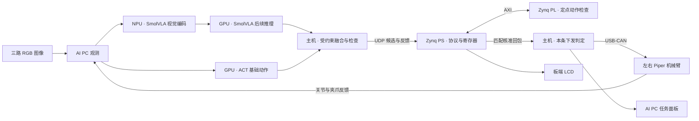

# FlexiFold 双臂毛巾折叠机器人

**AMD Ryzen AI PC × Zynq FPGA｜具身智能赛道技术报告**

折一条毛巾，最难的一步往往发生在第一折之后。布边已经移位，夹爪要重新对准并抓住它，两只手还要配合完成下一次翻折。FlexiFold 用三台相机观察布面和夹爪，由 Ryzen AI PC 生成双臂动作，再由 Zynq 可编程逻辑逐条核准策略目标。拿到本条核准，主机才将目标送给机械臂。

**750 条真实策略目标逐条获 FPGA 核准｜回包中位数 2.480 ms，最大 7.622 ms｜另一次现场试验由操作者确认完成预期折叠**

*图 1　现场确认折好的一轮。前六帧来自同一轮中视角录像，底部三帧为左、中、右终态。750 条核准数据来自采用异步写盘的后续实机运行。* [试验记录](flexifold_working_baseline/bimanual-towel-folding-ryzen-zynq/npu_deploy/fpga_authority/LIVE_ACCEPTANCE.md)

## 一、项目亮点

| 创新点 | 怎么实现 | 对折叠有什么用 |
| --- | --- | --- |
| 学习策略分工 | ACT 从示教中学习成段的双臂动作。SmolVLA 结合图像、关节状态和任务文本，在后台生成手臂修正。ACT 持续掌管夹爪目标 | 保留双臂协同和开合节奏，同时给手臂留下随新画面修正轨迹的空间 |
| FPGA 参与动作下发 | 自定义 RTL 检查本条候选的关节范围、步长、跟踪偏差、修正和夹爪归属。主机收到匹配且及时的核准后才下发 | 硬件判定直接影响本条动作。真实夹爪试验中，越界候选被拒绝，锁定期间两侧 CAN 发送增量均为零 |
| NPU、GPU 和 FPGA 分工 | XDNA NPU 运行视觉编码子图，Radeon GPU 执行 ACT 及 SmolVLA 的其余策略计算，FPGA 检查整数约束。视觉推理、LCD 和日志各自有独立执行路径 | 视觉修正可以后台计算，显示刷新和文件写盘从逐条收包路径移出 |
| 同一条动作跨设备复盘 | 用会话号与序号关联候选、PL 核准、SDK 下发记录和双端显示，再结合三视角录像、夹爪目标和反馈回放 | 既能定位动作为什么退出，也能追查动作照常下发时为什么没夹住布 |

## 二、从相机到夹爪

**硬件组成。** 实机验证平台采用 Ryzen AI 9 HX 370，集成 Radeon 890M 和 XDNA NPU。三台 Intel RealSense 435 系列相机提供左、中、右 RGB 画面，配置为 640×480、30 FPS。两台 AgileX Piper 各有六个关节和一个夹爪，各自通过 USB-CAN 与 AI PC 相连。Zynq-7020 经有线以太网连接主机，运行 B35 Overlay 并驱动 800×480 LCD。模型、观测处理、动作发送均在现场设备完成。 [平台与实板验收](flexifold_working_baseline/bimanual-towel-folding-ryzen-zynq/npu_deploy/fpga_authority/HARDWARE_ACCEPTANCE.md)

**输入和输出。** 中视角让评委看到布面整体变化，左右视角便于观察各自夹爪附近。策略输入为三张经训练配置预处理的 RGB 图像和 28 维状态，状态包含双臂关节及夹爪的位置与力矩相关反馈。每个控制步产生 14 维目标，每侧六个关节角和一个夹爪开口，单位分别为弧度和米。机械臂反馈进入下一轮观测。 [模型接口与参数](flexifold_working_baseline/bimanual-towel-folding-ryzen-zynq/readme.md#act-smolvla-and-asynchronous-inference)

## 三、AI PC 如何生成动作

**ACT 保持动作连续。** 项目训练的 ACT 50k 检查点一次预测 100 步动作，配置每次消费其中 50 步再更新。以首次抓取为例，左右臂接近、夹爪闭合与抬布是连续动作，动作块让模型一次给出这段配合。夹爪开口始终由 ACT 输出，便于把抓取节奏追溯到同一条策略链。

**SmolVLA 提供受约束的手臂修正。** SmolVLA 30k 将当前图像、双臂状态和折叠任务文本映射到候选动作块。引导式 RTC 在后台计算候选，并结合正在执行的动作序列衔接后续轨迹。默认在第 300 步启用接管逻辑。融合器按权重、修正幅度和逐步变化约束使用候选。当前实现也保留 ACT 原始与处理后目标，关节候选在边界外 0.02 rad 的小幅余量内投影到原限值，超出该余量时退出。

**视觉编码走 NPU，策略计算留在 GPU。** SmolVLA 视觉编码子图以 ONNX 部署，单次接口为 `[1,3,512,512] → [1,64,960]`。NPU 工作进程返回视觉特征，GPU 完成后续模型计算和引导式 RTC 所需的梯度计算。控制线程消费已经就绪的候选，模型推理时间和逐条核准时间各自记录。 [策略与核准入口](flexifold_working_baseline/bimanual-towel-folding-ryzen-zynq/amd_hybrid_deploy_20261031/piper_towel_replica/deployment_entry/cobot_hybrid.py)

## 四、FPGA 改版如何改变动作下发

### 4.1 从事后检查到逐条准入

**这次改版把 B35 的硬件判定放到了 USB-CAN 下发之前。** 旧版先下发策略目标，再把动作副本送进板卡，检查结果用于显示和复盘。新版在启用核准的任务中先固定本步候选，再等待 B35 检查。主机只有在收到本条的匹配核准后，才调用机械臂 SDK。原有 B35 定点逻辑继续使用，本次改动集中在检查的调用位置、候选与回包的绑定，以及超时和拒绝时的退出路径。

| 设计环节 | 旧版旁路检查 | 新版下发前核准 |
| --- | --- | --- |
| 检查时机 | SDK 发送后，旁路异步送检 | SDK 发送前，控制线程等待本条判定 |
| PL 结果 | 进入诊断记录和板端显示 | 进入主机下发条件，并进入诊断记录和显示 |
| 拒绝或超时 | 记录异常，策略下发独立运行 | 本条候选退出下发路径，本轮核准锁定 |
| 动作与证据关联 | 回查已发送动作的诊断副本 | 同一会话与序号关联送检候选、核准结果和下发回执 |

这里的分工很直接。**AI PC 负责生成动作与调用执行器，Zynq PL 负责对候选动作计算约束，AI PC 根据真实 PL 回包决定是否调用 SDK。** USB-CAN 仍接在 AI PC 上，连接、人工复位和退出保持走主机原生流程。 [旧版审计与新版接入](flexifold_working_baseline/bimanual-towel-folding-ryzen-zynq/npu_deploy/fpga_authority/PHASE1.md)

### 4.2 一条动作如何跨设备完成核准

1. **主机固定本条目标。** 策略融合后，主机保留本步原始目标，重新读取反馈并再次执行软件校验。发往板卡的量化目标与即将下发的浮点目标逐维核对。后续收到的核准只用于这一份候选。
2. **以太网携带候选和检查上下文。** FPG1 v3 请求长 392 字节，回复长 68 字节，均为小端布局。包头包含会话号、序号和主机单调时钟时间戳，尾部用 CRC32 校验报文。请求携带六组 14 维整数向量和步数等元数据。会话号区分不同轮次，序号区分同一轮中的每一步。
3. **Zynq PS 负责协议，PL 负责运算。** 板上的处理系统 PS 接收 UDP、解析报文，并通过 AXI4-Lite 向可编程逻辑 PL 写入参数和向量。最后写提交寄存器，等待完成后把违规位图、事件、阶段、板卡构建号和配置标识装入回包。
4. **主机核对再下发。** 核准器核对回包的协议版本、会话、序号、构建号和配置。随后用同一组量化向量运行整数参考，核对 PL 的违规位、事件和阶段。违规位为零，且反馈仍然新鲜、未收到停止请求、未超过截止时间，主机才对固定的原目标发起一次 SDK 调用。
5. **失败后停止本轮策略下发。** 板端拒绝、回包丢失或迟到、身份错误、参考不一致均会锁定本轮核准实例。过期回包失效，后续正常候选也无法沿用前一条许可。原生控制器读取当前测量姿态，执行退出保持。

**等待从哪里计时。** 20 ms 窗口从主机准备刷新反馈开始，到本条 SDK 调用开始为止，覆盖刷新反馈、二次软件校验、核准往返以及下发前的检查。主机用同一个单调时钟记录截止时间，板端用自己的单调时钟记录板内耗时。两端按会话号和序号对齐记录。 [报文定义](flexifold_working_baseline/bimanual-towel-folding-ryzen-zynq/fpga_integration/fpga_code/fpga_workspace/host/fold_protocol.py) · [主机核准实现](flexifold_working_baseline/bimanual-towel-folding-ryzen-zynq/fpga_integration/fpga_code/fpga_workspace/host/action_authority.py)

### 4.3 PL 里的定点检查如何实现

六组向量都按原单位乘以 1,000,000，编码成有符号 32 位整数。比如关节目标 0.1 rad 编码为 100,000，夹爪开口 50 mm 编码为 50,000。PL 在输入握手时锁存整条样本，逐索引扫描 14 个维度。每个维度上的多项规则由组合逻辑检查，同一维的违规位与累计结果按位或合并。最后一个维度检查完成时输出有效信号与违规位图。差值运算先扩展为 33 位再取绝对值，保留两个有符号 32 位操作数相减所需的位宽。

| 送检数据 | PL 用它回答什么问题 |
| --- | --- |
| 本条目标、ACT 基础动作 | 最终目标和送检的 ACT 基础值是否处于配置范围内？ |
| 本条目标、上一目标 | 相邻目标间的关节变化有没有超过允许步长？ |
| 测量反馈、上一目标 | 实际测得的关节状态是否偏离上次命令过大？ |
| 本次修正、上次修正 | 修正幅度是否过大？相邻两步的修正变化是否过快？ |
| 夹爪目标、ACT 夹爪目标、夹爪修正 | 最终夹爪值是否仍等于 ACT 目标，且夹爪修正为零？ |

这些检查把策略约定落实为可复算的硬件条件。例如，SmolVLA 可以修正手臂轨迹，夹爪两维仍要求最终目标等于 ACT 且修正为零。B35 运动检查使用该配置的定点阈值，反馈新鲜度由主机核准器在送检前和下发前检查。B35 实板逻辑时钟为 50 MHz。 [SystemVerilog 实现](flexifold_working_baseline/bimanual-towel-folding-ryzen-zynq/fpga_integration/fpga_code/fpga_workspace/rtl/motion_guard.sv) · [B35 构建与板卡验证](bimanual-towel-folding-ryzen-zynq/docs/FPGA_B35_RELEASE_zh.md)

### 4.4 怎样让板端判定跟上真实控制

动作需要等待回包后才能送出，网络收包、Python 寄存器访问和日志写盘都可能占用这条路径。工程上做了三处改动。

- **批量写 AXI 寄存器。** 六组向量从每包 84 次 Python 标量 MMIO 写入，改成每组一次数组赋值。板侧保留寄存器布局和最终提交顺序，数据写齐后再触发 PL。
- **LCD 独立渲染。** 板端通过有界非阻塞通道把状态快照送给独立显示进程。显示可以合并中间快照，保留累计计数和终态。主机面板与 LCD 用同一会话、序号关联核准状态和下发回执。
- **日志独立写盘。** UDP 服务把日志交给有界队列和写盘线程，减少逐包磁盘写入对接收路径的阻塞。一次较早的实机运行在第 695 条之后等到了迟到回包，控制器按截止时间退出。启用独立写盘后，后续一轮 750 条目标全部在原窗口内获得核准。 [板端桥接实现](flexifold_working_baseline/bimanual-towel-folding-ryzen-zynq/fpga_integration/fpga_code/fpga_workspace/board/fold_bridge.py) · [现场时序记录](flexifold_working_baseline/bimanual-towel-folding-ryzen-zynq/npu_deploy/fpga_authority/LIVE_ACCEPTANCE.md)

### 4.5 怎样证明 FPGA 的结果改变了执行

在双夹爪 5 mm 开合试验中，100 条真实目标先取得 B35 核准，再进入实际下发，左右夹爪均测得开合反馈。随后测试把送检副本的右臂 J2 改为 2.65 rad。实际 PL 返回违规位图 `0x7`，对应最终目标范围、基础动作范围和关节步长三项触发，主机整数参考结果一致。该候选未进入下发回调，随后一条正常目标也被本轮锁定拦下，两侧 CAN 在拒绝与锁定阶段的发送增量均为零。这组实测清楚展示了同一条链路的两个结果，**正常候选有真实执行，PL 拒绝直接阻断本条应用下发。** [实机开合与拒绝记录](flexifold_working_baseline/bimanual-towel-folding-ryzen-zynq/npu_deploy/fpga_authority/LIVE_ACCEPTANCE.md)

## 五、实机结果

| 试验 | 现场记录 | 验证内容 |
| --- | --- | --- |
| 真机折叠 | 操作者确认完成预期折叠。当轮下发了 676 条策略目标，下一条因 ACT 关节候选越过当时的软件下限而退出 | 毛巾折叠的物理结果，以及控制器的退出过程 |
| 采用异步写盘的完整控制运行 | 750 条真实策略目标全部获核准，零拒绝、零截止时间遗漏。RTT P50 / P95 / P99 / 最大值为 **2.480 / 3.326 / 5.035 / 7.622 ms** | 三路图像、ACT 到 SmolVLA/NPU 的接管、FPGA 准入及实际 SDK 下发在同一轮贯通 |
| 双夹爪 5 mm 开合试验 | 100 条实际目标逐条获 B35 核准。左右夹爪反馈最大开口增量为 4.6 / 4.1 mm。越界候选及随后锁定期间，两侧 CAN 发送增量为零 | 核准能放行动作，拒绝也能实际阻断应用层下发 |
| 板端故障补测 | **19 类故障**通过独立补测 | 校验异常、拒绝及退出等故障路径的处理 |

表中 RTT 由主机核准器计时，从进入本条核准处理到收到匹配回包，包含主机送检处理、网络、PS、AXI 与 PL。一轮较早的 750 步完整运行用时 28.242 s，平均 26.556 Hz。控制调度的配置目标为 30 Hz。 [现场验收记录](flexifold_working_baseline/bimanual-towel-folding-ryzen-zynq/npu_deploy/fpga_authority/LIVE_ACCEPTANCE.md) · [750 步逐项统计](local_environment_record/fpga_remaining_remote_20261115/buffered_full_trial/machine_validation_pending_observation.json) · [19 类故障补测](local_environment_record/fpga_remaining_remote_20261115/buffered_fault_retry.json)

## 六、第一折后的再次抓取复盘

在 750 步完整控制运行中，操作者指出第一折后的右侧布边和右夹爪开口存在问题。我们把这轮与现场确认折好的一轮按阶段对齐。在第二次抓取附近，成功轮右夹爪最大**目标**开口为 **60.1 mm**，对比轮为 **41.1 mm**。目标开口连续大于 25 mm 的时长分别约为 **2.90 s** 和 **0.91 s**。对比轮提前约 **1.56 s** 降到 10 mm 以下。差异在第 300 步 SmolVLA 接管前已经出现。

*图 2　成功轮与对比轮的右夹爪开口记录。左图对比最大目标开口，右图对比目标开口连续超过 25 mm 的时长。* [离线分析与试验记录](flexifold_working_baseline/HARDWARE_NEXT_STEPS.md#暂停真机后的右侧再次抓取离线分析)

下一轮试验可用中视角确认第一折后的整体布边，用右腕附近视角核对局部抓取位置，再联合夹爪实际开口反馈决定闭合时机。当前界面独立记录程序终态和现场观察标签，折叠结果由操作者根据布料终态确认。已有视觉几何规则在留出的 1 轮成功和 5 轮失败中均未触发成功候选，现阶段用于离线复盘。 [现场观察与视觉验证](flexifold_working_baseline/bimanual-towel-folding-ryzen-zynq/npu_deploy/fpga_authority/LIVE_ACCEPTANCE.md#视觉边界与数据保存)

## 七、展示与复现入口

*图 3　真实任务运行窗口。右侧显示 SmolVLA 当前融合权重，底部显示下发状态。按会话和序号可回查该步的硬件判定与下发记录。*

**现场展示顺序。** 先用图 1 看完整折叠，再用图 3 指出一次策略接管后的真实控制画面，最后用真实板端拒绝记录展示同一套接口怎样放行正常候选、挡住越界候选。板端 LCD 和 PC 面板可沿同一会话观察送检、核准、下发回执及终态。原生复位有自己的阶段回执，便于连续展示时跟踪双臂回到起点的过程。 [板端实际 LCD 画面](local_environment_record/fpga_remaining_remote_20261115/buffered_full_trial/actual_board_lcd_latest.png)

| 工程入口 | 复现内容 |
| --- | --- |
| [运行环境与模型资产](flexifold_working_baseline/README.md) | 恢复模型检查点、预处理器、NPU 编码器和匹配的主机运行环境 |
| [现场运行及显示指南](flexifold_working_baseline/bimanual-towel-folding-ryzen-zynq/npu_deploy/showcase_guide_zh.md) | 绑定三路相机与双路 CAN，核对板端服务，执行预检并查看任务、复位和状态回执 |
| [FPGA RTL 与构建工程](flexifold_working_baseline/bimanual-towel-folding-ryzen-zynq/fpga_integration/fpga_code/fpga_workspace/) | 查看 RTL、Vivado 工程、Overlay 与寄存器接口，复核定点判定 |
| [实机验收与诊断入口](flexifold_working_baseline/bimanual-towel-folding-ryzen-zynq/npu_deploy/fpga_authority/LIVE_ACCEPTANCE.md) | 核对真实夹爪试验、受限策略试验、板端延迟与故障注入结果 |
| [展台互动与数据采集](flexifold_working_baseline/flexifold_booth_first_grasp/readme.md) | 复盘首次抓取，按回合保存示教动作和图像。真实采集与合成排练分别归档 |

实现基线为 `fpga-authority` 分支的 `aa6ddcb`。本文的动作核准描述对应已完成实机验证的核准模式。通用执行入口依据匹配版本的资格报告启用。 [当前工程状态](flexifold_working_baseline/HARDWARE_NEXT_STEPS.md)
