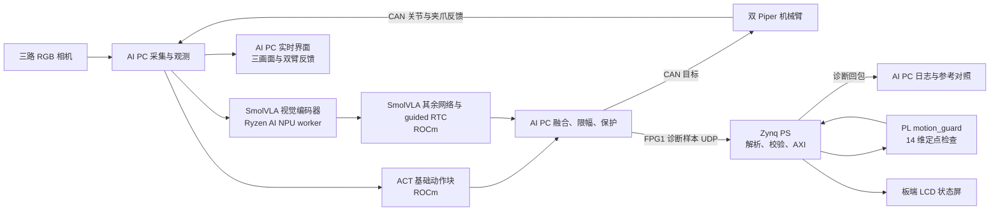
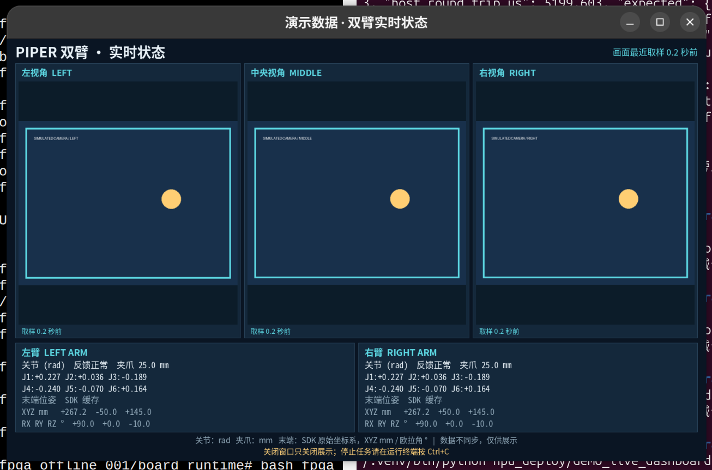

# 基于 AMD Ryzen AI PC 与 Zynq-7020 的双臂具身智能系统技术报告

**项目类型：**具身智能、双臂机械操作、端侧多模态推理、FPGA 旁路硬件检测  
**报告状态：**技术交接与汇报初稿，依据截至 2026-11-02 的本机源码、两次现场运行记录和用户确认整理。  
**重要约定：**本报告明确区分实测、软件设计、离线模拟与待验证项目。控制程序走完预设步数不等同于毛巾折叠成功；屏幕出现界面不等同于机械臂安全；FPGA 本阶段不具有机械臂动作的放行、拒绝或急停权。

## 1. 项目摘要

项目面向桌面双臂折叠毛巾任务，使用一台 AMD Ryzen AI PC 连接三路 RGB 相机和两只 Piper 机械臂，在本地运行 ACT 与 SmolVLA 混合策略。ACT 负责提供基础动作块，SmolVLA 以异步 guided RTC 方式提供受限的手臂修正；软件保留当前训练模型的输入、输出、归一化、动作裁剪和保护逻辑。SmolVLA 中的视觉编码器通过独立 Ryzen AI NPU 工作进程执行，其余模型和控制继续使用 ROCm/PyTorch 路径。

正点原子启明星 V2 Zynq-7020 通过有线网络连接 AI PC。主机将实际控制循环中生成的动作目标、反馈、历史目标、基础动作和修正量编码成定点数据，经 UDP 交给板端 PS；PS 校验报文并经 AXI4-Lite 调用 PL 中的 `motion_guard` 检查器，返回违规、事件和名义阶段。板端 LCD 显示检查状态。当前实现属于**异步诊断旁路**，返回结果用于日志和对照，不回写或裁决机械臂动作。

现场记录显示，至少两次控制程序以 `execute=True` 完成 750 步；其中最新一次 751 条 FPGA 请求含 1 次探针，全部收到回复，750 条任务记录与软件整数参考一致。该记录没有附带本报告可核验的独立折叠成功标注，故任务成功率、实际物体状态及完整比赛指标仍待补充。软件界面目前已通过模拟展示；真实三路相机和末端位姿的新版界面仍待现场只读检查。

## 2. 赛题对照与真实边界

参考随包 `docs/track_requirements.md` 的 3.2.2—3.2.5。

| 赛道要求 | 项目现有实现 | 当前证据边界和待办 |
|---|---|---|
| AMD Ryzen AI PC 本地推理、界面和调度 | AMD CPU、Radeon 860M ROCm、Ryzen AI NPU；本地双策略、界面、准备与任务脚本 | NPU 子图和首次视觉执行有日志；须补多样本推理指标和模型效果测量 |
| Zynq/FPGA 有明确硬件设计 | AXI4-Lite 包装的 14 维定点检查器、watchdog、LCD 帧缓冲 RTL 与联合 Overlay | FPG1 实测为旁路检查；不能将诊断结果描述成动作门控或认证级安全保护 |
| 两端协同 | UDP 报文、双端会话和计数、板端 PS/PL、结果回传、LCD | 已有回包和整数参考；通信异常不停止机器人，闭环保护机制尚未实现 |
| 真实物理任务 | 两次控制程序记录各执行 750 步，实际下发动作 | 缺少独立的任务成功判据与次数、成功视频评审记录；不能填报成功率 |
| 时间同步 | 单机本地单调时钟、帧缓存取样记录、板端本地计时 | 未建立跨设备统一硬件时钟；不得将 RTT/板端耗时当成端到端单向延迟 |
| 可复用工作流 | 准备、正式运行、只读检查、显示启停、NPU 离线对照脚本 | 干净环境复现、跨场景复用和持续稳定性尚待独立验证 |

赛题接受低延迟数据处理、RTL/AXI 外设等 FPGA 设计，但对于作品是否充分满足“两端协同闭环”和量化贡献，应由评委依据实际演示与规定判断。现有系统中，**AI PC 与机械臂可以形成感知—决策—执行反馈链；FPGA 是观测该链路的硬件旁路，而不是动作链中的闭环门控**。需在答辩中如实说明这一限制，不将屏幕状态包装成安全联锁。

## 3. 硬件与软件组成

### 3.1 已使用硬件

| 设备 | 本机观察/配置 | 作用 |
|---|---|---|
| AI PC | ASUS TX Air FA401KM；AMD Ryzen AI 7 H 350 w/ Radeon 860M；系统可见约 30,683 MB 内存 | 相机采集、策略推理、RTC、Piper 控制、上位机界面与日志 |
| AMD 核显 | Radeon 860M，ROCm 所见架构 `gfx1152` | PyTorch ROCm 策略推理和运算 |
| AMD NPU | `NPU Krackan 1`，BDF `0000:67:00.1`，`aie2p` | SmolVLA 视觉编码器实验路径 |
| 独立显卡 | 机器 PCI 列表还显示 NVIDIA RTX 5060 Laptop GPU | 本报告所述 AMD ROCm/NPU 路径不以其作为计算证据 |
| 机械臂 | 两只 AgileX Piper，从臂；各自 USB-CAN，逻辑名 `can_left`、`can_right`，1 Mbps | 接收关节和夹爪目标，提供状态反馈 |
| 相机 | 三只 Intel RealSense 435 系列，使用 RGB 流；代码配置 640×480、30 FPS | 左、中、右三路场景观测；不把深度数据声称为当前模型输入 |
| FPGA | 正点原子启明星 V2，XC7Z020；Vivado part `xc7z020clg400-2`，PYNQ | ARM PS 执行 UDP 服务；PL 实现检查器、LCD1 与独立 watchdog |
| 显示屏 | 板端实测 LCD ID `0x4384`；物理 800×480，运行时 480×800 画布 | FPGA 监测信息；三路摄像头画面显示在 AI PC 上，不经 FPGA 视频通路 |
| 通信 | AI PC `192.168.2.10`，FPGA `192.168.2.99`；示例实际 USB 有线网卡协商 100 Mbps | PC 与板端 UDP 诊断；IP 为现场实例，重建时按实际网络调整 |

USB 扩展坞需供电和带宽足够；CAN 名称依 USB 序列号重新绑定，视频节点依相机身份重新识别。`/dev/video14` 等编号会变化，不能把历史编号当成硬件身份。每只机械臂有独立电源、CAN 接口和可触达急停。不要将 FPGA USB 串口当成当前高速业务通道；现场已证明可通过 Jupyter 管理板端，保留以太网数据连接。

### 3.2 已记录的软件版本

| 软件 | 现场记录 |
|---|---|
| OS/内核 | Ubuntu 26.04 LTS；Linux `7.0.0-38-generic` |
| ROCm / HIP | ROCm 7.14.1；PyTorch 显示 HIP `7.14.60850` |
| PyTorch | `2.11.0+rocm7.14.1` |
| XRT / amdxdna | XRT 2.26.89；amdxdna `2.26.260102.59.release_20261022` |
| NPU firmware | `1.1.2.64` |
| ONNX / ONNX Runtime | 导出记录 ONNX 1.22.0、opset 17；NPU 检查记录 ONNX Runtime 1.30.0 |
| Python | AI PC 主部署 Python 3.12；板端运行包使用 PYNQ Python 3.8 环境 |
| FPGA 工具/框架 | PYNQ 2.7 历史板测记录；Vivado 版本、镜像身份以实际构建日志为准 |

版本是现场记录，不代表在其他型号、发行版或驱动组合已经验证。本源码包不带 Python 环境、驱动、模型和系统镜像；依赖清单供重新配置，不是可执行环境快照。

## 4. 系统总体架构



两条关键路径的区别：

1. **执行路径：**AI PC 从相机和机械臂读取观测，执行 ACT/SmolVLA 和软件保护，再通过 CAN 下发目标，机械臂返回反馈。
2. **FPGA 诊断路径：**主机验证、实际下发之后，异步提交对应样本；旁路线程排队、发送、接收并记录。FPGA 结果不阻塞动作、不授权动作，不通过 FPG1 喂给 FWD1 watchdog。

这不是“FPGA 检查通过后机械臂才动作”的系统。要改成这种闭环结构，需要重新设计协议、调度、失联响应和逐级验证，不是把当前旁路标志直接接入执行判断。

## 5. 数据、模型与控制

### 5.1 输入输出合同

- 模型状态为 28 维：左侧 6 个关节各 `.pos/.effort`、夹爪 `.pos/.effort`，再按相同结构排列右侧。顺序以模型 features 和配置为准，不能直接假设 Python 字典插入顺序。
- 动作为 14 维：左关节 1–6、左夹爪、右关节 1–6、右夹爪。关节使用弧度，夹爪使用米；界面显示夹爪时换算为毫米。
- 左／中／右相机以原始 RGB 缓存进入原有处理。模型各自 normalizer 之前按历史训练约定应用 `[2,1,0]` 色通道置换；界面显示使用原始缓存，不应将显示用转换回写给模型。
- 训练统计中恒定为零的 effort 通道通过专用适配器使用训练常数；原始遥测和关节位置不被替换。
- 训练起点配置含 14 维目标；源码交付保留运行所需起点与原训练 `task_frames=900` 元数据，但现场预算单独配置为 750 步。所保留的起点向量是运行配置，不是完整原始训练数据。

### 5.2 ACT 与 SmolVLA

| 项目 | 当前配置 |
|---|---|
| ACT | 自有 `act050000`；chunk size 100，`n_action_steps=50`，保留 checkpoint 的队列语义；不人为覆盖 temporal ensemble |
| SmolVLA | 自有 `smol030000`；chunk size 50、10 步去噪、16 层 VLM、expert width multiplier 0.75 |
| 基座 | `HuggingFaceTB/SmolVLM2-500M-Video-Instruct`；既有模型资产 revision `7b375e1b73b11138ff12fe22c8f2822d8fe03467` |
| RTC | guided 模式；EXP 前缀注意力、guidance weight 2.5、execution horizon 10；默认在第 300 步进入接管逻辑 |
| 视觉 NPU 子图 | ONNX 输入 `[1,3,512,512]`，输出 `[1,64,960]`；导出记录 float32、opset 17，设备内部精度以实际编译报告为准 |
| 输出组合 | ACT 作为基础目标；经信任条件、幅值和变化率约束的 Smol 修正只作用于手臂；夹爪保持 ACT 所属 |
| 控制频率 | 配置目标 30 Hz，完整演示上限 750 步；实际频率和卡顿须以实测为准 |

NPU 采用进程隔离：AI PC 主进程保留 ROCm、策略和 RTC 自动求导；NPU worker 使用 Ryzen AI 环境、XRT 和 Vitis AI EP，处理图像嵌入。`NPU_PARTITION_CONFIRMED` 表示运行时报告 NPU 子图，`NPU_FIRST_INFERENCE_COMPLETED` 额外表明至少一次视觉推理完成；二者都不代表整个 SmolVLA 模型或完整控制都运行在 NPU 上。

另有 FastFlowLM 非 guided 实验脚本，曾做固定输入前向对照，但未覆盖项目的 guided RTC 及真实控制；本方案正式路径不应声称使用它完成整机任务。

### 5.3 重要安全和数据语义

- 原 SDK 和主机软件中的限位、控制周期和错误处理是当前动作路径的一部分；不要为让演示继续而直接提高阈值。
- 本次使用的 FPGA profile 中，反馈年龄检查关闭：`max_feedback_age_us=null`，并非“所有反馈新鲜”。
- 软件收到 Ctrl+C 后请求停止，并尝试保持测得姿态；驱动或计算阻塞时可能延迟，不能保证物理保持。现场急停与物理隔离独立于界面。
- 三路相机取样、CAN 反馈和末端位姿由不同线程和消息产生，没有硬件曝光同步。界面时间只是主机采样/SDK 接收时间，不是传感器共同时间。
- 末端姿态来源为 Piper SDK 缓存，XYZ 换算为 mm，RX/RY/RZ 换算为度；不同机械臂的底座和世界坐标系未经统一标定，不能将两个 XYZ 直接当作同一个世界坐标系中的位置。

## 6. FPGA／Zynq 实现

### 6.1 PS 与 PL 划分

PS 的 Python 程序负责网卡 UDP、消息边界、CRC、地址/会话校验、profile 选择、AXI MMIO 读写、日志、LCD 帧绘制和启动退出。PL 的 RTL 负责固定配置下的定点向量计算、检查结果和 watchdog 状态机，也提供 LCD 帧缓冲和扫描输出。UDP、CRC、身份校验本身不是在 PL 中实现；不得将整个 2 ms 级板端调用耗时说成纯 RTL 核心延迟。

板端入口：`fpga_integration/board_runtime/board/runtime.py`。对应 RTL、testbench 和构建 TCL 位于 `fpga_integration/fpga_code/fpga_workspace/`。随包提供的板端 `task_monitor.py`、`pynq_udp_server.py` 已合入实际安装并板测的 5 秒空闲会话切换修正；工作区开发副本保留原始版本以供对比。

### 6.2 14 维 `motion_guard`

每笔请求包含六组 `int32[14]`：`target`、`measured`、`previous`、`act`、`correction`、`previous_correction`，以及步数、标志和配置标识。角度与米均乘 `1,000,000` 量化；分别得到微弧度和微米。RTL 对两个 32 位有符号数做差时先扩展，以避免 32 位溢出后取绝对值造成误判。检查包括：

- 最终目标与 ACT 基础目标绝对范围；
- 关节单步、目标和反馈的差值；
- Smol 修正幅度、变化率；
- 夹爪是否仍由 ACT 持有；
- 可选起点和反馈年龄检查；
- 750 步预算和第 300 步名义 handoff 事件；
- 请求 profile CRC 是否匹配。

违规位与事件位定义见源码包 `fpga_integration/fpga_code/fpga_workspace/docs/protocol.md`。`scheduled_phase` 是配置驱动的名义阶段，不证明实际抓取、折叠或策略采纳。每个整数边界与 float32 边界附近可能出现量化差异，应做专门边界验证。

### 6.3 AXI 地址与显示逻辑

硬件基地址、寄存器映射以实际 HWH 和构建脚本为准；已验证方案中 guard 位于 `0x43C00000`，LCD 位于 `0x44000000`。

| guard 偏移 | 功能 |
|---|---|
| `0x00` | BUILD_ID，当前 `0x46504732` |
| `0x04 / 0x08` | 启动检查 / busy、done 状态 |
| `0x10–0x20` | profile、step、flags、反馈年龄和队列深度 |
| `0x40 / 0x44 / 0x48` | violations、events、scheduled_phase |
| `0x4C–0x68` | watchdog 控制、提交、状态、计数和间隔 |
| `0x100` 起 | 六组 14 维向量，按寄存器表映射 |

LCD1 为 4 bit／像素、16 色、双帧缓冲；每页 192,000 B，消隐期翻页，驱动读取 BUILD_ID、屏幕 ID 和代数。物理 800×480，Pillow 画布为 480×800。硬件 `lcd_bl` 与 enable 等条件关联，因此正常关闭显示前端会请求关闭背光；这一效果在现场独立生命周期测试中得到用户确认。LCD 设计用于低频状态显示，不是三路视频流处理器。

### 6.4 资源与时序（构建报告，不是任务运行计时）

以下来自随包 `fpga_integration/fpga_code/fpga_workspace/overlay/lcd_framebuffer_20261101/` 的实现报告，针对 LCD1 + guard 联合设计：

| 项 | 报告值 | 器件可用量 / 占比 |
|---|---:|---:|
| Slice LUT | 6,357 | 53,200 / 11.95% |
| Slice FF/Register | 9,379 | 106,400 / 8.81% |
| Block RAM Tile | 96 | 140 / 68.57% |
| DSP | 1 | 220 / 0.45% |
| 逻辑时钟约束 | 50 MHz | 20 ns |
| LCD 像素时钟约束 | 25 MHz | 40 ns |
| WNS / TNS | +4.616 ns / 0.000 ns | 报告声明用户时序约束满足 |

历史板上计数比对估算约 49.98 MHz，不是示波器测频。HWH 曾因板端启动时钟配置做过适配；更换 PYNQ 镜像、FSBL 或板卡后需要重新核对频率、实际引脚、地址和时序，不能只复制 HWH 并声称适配。

## 7. 通信、时间与生命周期

### 7.1 FPG1 诊断数据

FPG1 使用 UDP 端口 9009、小端序。帧头包括 magic `FPG1`、版本、类型、长度、session、sequence、主机单调时钟 tick，末尾为 CRC32。请求 392 B（payload 364 B），响应 48 B（payload 20 B）。返回五个 `uint32`：profile CRC、violations、events、scheduled phase、板端调用耗时。主机核对响应身份和序列；CRC 用于检测传输损坏，不用于认证或加密。

主机只保留有界队列并在后台发送；队列满、超时、丢包或板端退出时，记录告警，**不会替机器人停机**。当前板端限制允许的源 IP，并在上一会话空闲 5 秒后接受新会话序号 0；这适合单个主机的诊断演示，不是多控制器仲裁或安全授权。另有 FUI1 任务显示状态通道；当前正式入口主要发送 `WAITING/IDLE`，不能声称它自动识别了折叠阶段。

### 7.2 生命周期服务

`npu_deploy/fpga_lifecycle/` 提供后台管理器：板端 systemd 管理进程在 UDP 9010 接收带 HMAC 的 `start/finish/status`，限定 AI PC 源 IP；`start` 启动 PYNQ runtime，`finish` 安排 10 秒后向 runtime 发送正常停止信号，runtime 关闭 LCD 并恢复基线 Overlay。新准备请求可以取消尚未执行的关闭。

AI PC `prepare_showcase.sh` 会请求启动并等待 FUI1 响应；`start_showcase.sh` 启用自动关闭，任务进程正常结束或可处理的中断后由包装脚本请求 10 秒关闭。管理器常驻供下一轮唤醒，启用开机启动；被管理的屏幕/诊断服务不是始终运行。若主机或进程被强制杀死、网络丢失，结束请求可能无法送达，不能保证自动关屏；使用 `control_client.py status` 与板端 `systemctl status fpga-lifecycle` 检查。

密钥只在 AI PC 本机 `npu_deploy/artifacts/fpga_lifecycle/control.key` 和 FPGA 安装后受限目录中保存，通过用户的 Jupyter 上传方式建立。**本包不包含密钥或带密钥的安装包，禁止把实际密钥提交到 Git。**该通道只管理诊断服务，不发送电机命令。密钥和 IP 是本机配置，部署到其他设备必须重新生成并核实。

### 7.3 时钟与延迟口径

- 主机请求 tick、主机队列和控制循环使用本机单调时钟；SDK CAN 接收时间为另一个时间来源，需确认与系统时间的关系。
- 板端处理耗时以板端本地 monotonic 时间测量；RTT 在 AI PC 一端测量发送至匹配回包，包含网络、板端 PS、AXI、PL 和调度。
- 两机没有证明时钟同步，也未测相机曝光到关节真实物理响应；因此不报告跨时钟单向延迟或完整端到端延迟。
- RTT 小不代表动作控制更快，因为 FPGA 当前并不处于动作放行路径中。报告中的 `board_processing_us` 是板端一次调用范围，不是独立硬件核心的纯逻辑时间。

## 8. AI PC 软件界面和操作



图为用户提供的 **模拟预览截图**：三路画面及关节数据均由演示程序生成，不能作为真实摄像头或实机完成任务的证据。上部为左、中、右视角，下部为左右臂关节、夹爪和末端姿态。真实运行时显示复用原任务已有的相机 `read_latest()` 缓存及 Piper SDK 接收缓存，不新开同一相机、不发送动作目标；界面独立进程与单帧有界队列，目标约 5 Hz。单路取样或状态过期会显示告警，不能把 UI 视为安全功能。

`demo_live_dashboard.py` 用模拟画面检查桌面、字体和排版；`run_dashboard_readonly.sh` 为真实相机/CAN 的 20 秒检查，SDK 可能发送状态查询，但不使能、复位或下发运动。当前用户反馈检查曾因两只 USB-CAN 与三路相机未枚举而在连接前退出；因此**真实设备上的新版界面尚未验收**。正式 `start_showcase.sh` 在策略开始时带 `--preview`，自动打开界面；界面打不开会在策略连接机械臂前中止，但其前一阶段的复位可能已经执行，故先做模拟和只读检查。

界面中文由 Pillow 直接使用 Noto CJK 字体绘制，绕过当前 Tk/X11 后端缺字。关闭窗口只关闭显示，不停止任务；Ctrl+C 需在运行终端执行。渲染进程与控制进程共享同机和 systemd scope，虽然不直接等待 UI，仍可能争用 CPU、内存带宽，须用有界环境测量开启/关闭界面时的控制周期。

## 9. 已有测试与量化结果

### 9.1 两次真实执行记录

两次本机 `trace.json` 均记录 `execute=True`、`termination_reason=action_budget`、各 750 行；这说明程序到达动作预算，不证明物理折叠成功。

最近一次记录（项目原机本地证据，不随本源码包附带）：

| 指标 | 结果 | 口径 |
|---|---:|---|
| 控制程序动作数 | 750/750 | 一次 `execute=True`，上限结束；物体结果未标注 |
| 运行时长／均值频率 | 26.907 s / 27.873 Hz | 控制日志 `COBOT_RUN_SUMMARY`；包含本次运行开销 |
| 相邻控制 tick 时间 | P50 33.398 ms；P95 33.435 ms；P99 139.451 ms；最大 406.724 ms | 749 个相邻 `tick_monotonic_s` 差，P95/P99 最近秩；非物理响应延迟 |
| ACT pipeline 用时 | P50 3.923 ms；P95 17.032 ms；P99 138.285 ms；最大 405.654 ms | 750 条 `act_pipeline_s`，最近秩；包含该阶段代码路径，不等同纯模型时间 |
| ACT pipeline 超预算次数 | 19 | 原控制日志统计该阶段用时超过 `1/30` 秒；不直接等同系统级截止期未命中率 |
| Smol 候选采纳 / 拒绝 | 284 / 139 | 本次日志计数，仅该轮，不是任务成功率 |
| FPGA 请求/回复 | 751 / 751，超时 0 | 含启动探针 1 次及任务样本 750 次 |
| FPGA 对照 | 750 / 750 匹配；违规 0 | 与软件整数参考同规则比较；不能理解为物理安全认证 |
| FPGA 往返 | P50 4.644 ms；P95 5.313 ms；P99 7.175 ms；最大 25.537 ms | 750 个任务样本；最近秩；含 UDP、PS 与 PL 调度 |
| 板端处理范围 | P50 2.128 ms；P95 2.286 ms；P99 2.512 ms；最大 5.011 ms | 750 个任务样本；板端本地测量，不是 RTL 单独延迟 |

另一轮 750 个任务样本的 RTT P50 5.066 ms、P95 8.926 ms、最大 23.946 ms，751/751 回包。两轮各是单次执行，不足以证明长期可靠性或不同场景成功率。

### 9.2 NPU 与离线对照

- 固定观测的一次预热、三次重复测量：guided 原 ROCm `1.157–1.184 s`，NPU 视觉 + ROCm `0.745–0.751 s`；只是同一输入的短样本，不可外推完整任务吞吐或稳定尾延迟。
- 一份现场缓存图像及状态的固定输入对照：guided 最大关节差约 `0.01650 rad`，最大夹爪差约 `0.347 mm`；各路径一次，未预热，图像与状态没有硬件同步。
- NPU 视觉检查中三路输出有效、日志报告 `Actually running on NPU 1`。正式运行日志还记录 `NPU_FIRST_INFERENCE_COMPLETED`，输出形状 `[1,64,960]`。
- 50 步离线理想化回放中，两路径均结束，2 步来源判断不同；该回放用上一指令代替实际反馈，不是实机闭环。

### 9.3 验证局限

所有数字只反映对应日志中的设备、时间和具体口径。正式提交所需原始日志、结果截图与实际环境可单独由队伍审核后补充；它们因用户要求未包含在本包。时间戳应与真实事件发生时间区分，板端系统时钟曾不准确。界面新增后的真实相机、真实末端反馈和开启界面后的控制性能尚无完整实测。

## 10. 必报指标缺口与实验方案

| 指标 | 当前状态 | 建议补证方法 |
|---|---|---|
| 闭环任务成功率 | **待测** | 预先定义铺平、抓取、折叠位置误差、人工干预；重复 N 次，逐次记录成功/失败和视频证据 |
| 传感到物理响应 P50/P95/P99/max | **待测** | 定义曝光或采集起点、执行器开始物理运动终点；统一时钟/硬件触发，并保存原始时间与校准误差 |
| AI 效果 | **待测** | 多场景、布料位置与光照的任务成功／动作误差；标注各 checkpoint 和失败原因 |
| 模型推理拆分 | 部分离线短样本 | 同输入、同精度、预热后多次测量预处理、ACT、Smol guided、后处理及总时延，报告分位数 |
| FPGA 处理贡献 | 有 750 次板端调用统计 | 补纯 PL 周期/测试边界，建立相同样本 CPU 软件基线；谨慎报告资源与差异，不虚构加速比 |
| PC–FPGA 通信 | 已有 RTT、回复率 | 多轮持续测试，单列 P99、丢包、乱序、重启和故障恢复；吞吐用有效负载测量 |
| 实时控制 | 有 tick 和 ACT pipeline 时延 | 明确定义实际 deadline、抖动、跟踪 RMSE、超调；不以相邻 tick 大于标称周期简单代替截止期未命中 |
| 可靠性 | 未系统统计 | 连续运行、断网、异常退出、自动关屏、人工急停测试；记录次数及恢复时间 |
| 资源、时序、功耗 | FPGA 有实现报告；功耗待测 | 记录完整 Vivado 版本与约束，测 PC/FPGA 各自或整机功耗，说明仪表和供电边界 |
| 工作流复用 | 尚无独立干净机复现 | 在另一台兼容主机按本报告安装，记录耗时、缺失件和错误；未经验证不声明可直接跨平台运行 |

`metrics/metrics.csv` 给出可确认值与待填项。当前包不包含赛题要求的全部原始证据，因此**不能仅靠本压缩包声称比赛提交项完整**。

## 11. 从源码复现：前置条件与步骤

### 11.1 获取缺失资产和搭建环境

本包有源代码、配置、依赖清单及 FPGA 的 `.bit/.hwh`，**不含模型权重、NPU 导出产物、训练原始数据、虚拟环境、Python/ROCm/Ryzen AI 安装包或控制密钥**。复现者需要自行具备合法可用的对应资源：

1. 安装兼容的 Linux、AMD ROCm、Ryzen AI、XRT/amdxdna、Piper SDK、USB/CAN 和视频驱动；建立 Python 3.12 主环境，并按 `amd_hybrid_deploy_20261031/requirements/` 和第三方项目许可安装。板端需要与位流相匹配的 PYNQ 环境和 LCD 硬件。
2. 在 `amd_hybrid_deploy_20261031/.venv` 创建主环境，或根据脚本修改解释器路径。部分 NPU 脚本固定查找项目根目录 `ryzen-ai-npu/venv`，需建立正确的 Ryzen AI 环境并检查 `vision_client.py` 的库路径。
3. 将自有 checkpoint 放回 `amd_hybrid_deploy_20261031/piper_towel_replica/models/act050000` 和 `models/smol030000`；将对应 SmolVLM2 底座与所需处理器文件恢复到代码期望位置。它们不是公开模型下载地址的替代品，需要原权属人提供或许可。
4. 按原训练和导出配置自行生成 `npu_deploy/artifacts/smol_vision/` 的 ONNX、`export.json`、固定对照图像及参考；`hybrid_entry.py` 会比对模型、配置和 ONNX 摘要。不得用不同 checkpoint 的 ONNX 冒充原资产。
5. 固定原机验证时的摘要：ACT 权重 `845f8ba87a16dde7a9d0cf3daca13a899d187e7b6a5228ebd67a1c9d428b97d6`；SmolVLA 权重 `6e2ee82cb80090681aee42395cc96282d6e2b6d27e182b0f3c704c8d78b39afe`；该次导出 ONNX `1e719cc0c4a9e63c49fe671598cb79e99aa71cdfe24b1d83e2c131c827ce6b20`。这些是文件身份示例，不代表本包含有对应文件。

特定脚本仍有现场路径、固定 IP 和 Python 环境假设，不能声称直接在所有机器开箱即用。应先读 `npu_deploy/vision_client.py`、`npu_deploy/fpga_lifecycle/board_manager.py`、配置文件和设备脚本，替换本地路径、IP 与设备身份，再在无动作条件下逐项验证。

### 11.2 板端部署与自动启停

1. 将源码包中的 `fpga_integration/board_runtime/` 上传到 PYNQ 的 `/home/xilinx/jupyter_notebooks/fpga_offline_001/board_runtime`，保持相对目录。该副本已包含 5 秒空闲会话修正；不要对该副本再次应用要求“原版文件”的旧补丁安装器。
2. 校对 `.bit/.hwh` 是否与板卡、时钟和接线一致，检查 `/etc/profile.d/xrt_setup.sh` 和板端 XRT；本现场 systemd 启动需使用 `XILINX_XRT=/usr` 等 PYNQ 环境。若设备或镜像不同，需要重新验证。
3. 在 AI PC 执行 `python3 npu_deploy/fpga_lifecycle/create_install_package.py`。它生成**新的本地私有密钥**和包含密钥的临时安装包；将该私有安装包通过可信的 Jupyter 页面上传到自己的板卡，而不是公开发布。
4. 在板端停止旧的 `board.runtime` 进程，从上传包执行 `install_on_board.sh`，按脚本检查 systemd 服务是否为 `active`。安装器会在 `/etc/systemd/system/` 创建并启用 `fpga-lifecycle.service`；需 root 权限。请先审阅源码和 IP 白名单。
5. AI PC 与板端保持同网段，按实际地址修改 manager 的允许源 IP 与 client 的目标地址。通过生命周期客户端 `start`，再运行 `fpga_repeat_check.py` 验证两次 FUI1 和 PL 探针；`finish` 后等约 10 秒确认屏幕熄灭及 `status=stopped`。FPGA 重启后管理服务按 systemd 配置启动，诊断 runtime 由准备请求唤醒。

若 `No Devices Found`，先停止不断重启的测试服务，检查 PYNQ 设备、XRT 环境和完整错误；不能用仅有 ping 证明 PL 可用。停止服务会退出该诊断通道，不能当成机械臂急停。

### 11.3 AI PC 检查、预览和任务

从源码根目录开始；以下命令是本项目入口，必须先补齐上述资产，且示例配置需要针对当前设备复核。

```bash
# 静态命令检查，不打开硬件
bash npu_deploy/prepare_showcase.sh --check-only
bash npu_deploy/start_showcase.sh --check-only
bash npu_deploy/run_dashboard_readonly.sh --check-only

# 纯模拟图形界面，不访问机械臂、相机或 FPGA
./amd_hybrid_deploy_20261031/.venv/bin/python npu_deploy/demo_live_dashboard.py --seconds 30
```

连接并供电后，先按 USB 身份绑定两臂和三路相机，确认角色和实际画面；以下准备流程不发送使能或动作目标，但会配置 CAN 并可能请求 sudo：

```bash
bash npu_deploy/prepare_showcase.sh
```

准备阶段会逐步等待 Enter，检查 FPGA 管理通道并唤醒屏幕，运行受内存限制的 NPU 预检。若只想验证真实界面，确保其他任务已停止后运行：

```bash
bash npu_deploy/run_dashboard_readonly.sh
```

该命令有独立 4 GiB / 2 核 scope，打开真实相机与 CAN，SDK 会发送设备查询，不发送使能或动作；不能与正式运行同时占用同一相机。

正式运行由操作者在工作区无人员且急停可达的条件下执行：

```bash
bash npu_deploy/start_showcase.sh
```

依次按 Enter 展示 AMD、验证 FPGA、确认复位（机械臂实际运动）、再次确认后运行最多 750 步的 hybrid 和监控界面。`q` 可在确认点退出，Ctrl+C 为请求停止；系统的紧急处置依现场急停与安全流程。过程需要持续观察真实机器人，不能单凭界面绿色或 FPGA 0 违规放行。

### 11.4 离线软件与 RTL 验证

主机测试例：

```bash
./amd_hybrid_deploy_20261031/.venv/bin/python -m unittest discover -s npu_deploy/tests -v
./amd_hybrid_deploy_20261031/.venv/bin/python npu_deploy/fpga_lifecycle/test_lifecycle.py
./amd_hybrid_deploy_20261031/.venv/bin/python npu_deploy/fpga_lifecycle/test_task_cleanup.py
```

FPGA RTL 源与 testbench 在 `fpga_integration/fpga_code/fpga_workspace/rtl/`，相应 TCL 构建入口位于工作区根部；仿真与构建需要匹配版本的 Vivado 及目标板约束。已有历史验证材料的样本数和条件见对应源码文档，但源码包没有完整原始板测文件。复制到不同开发环境后，TCL 中的工程路径、PYNQ HWH 及 IP 支持需重新核实。

开发工作区中部分 FPGA 回放测试引用的 `tests/fixtures/` 含历史板端事件；按不打包原始记录的要求，本包未附带这些夹具。因此不能直接声称 FPGA 工作区全量回放测试开箱即用；需要经授权恢复夹具或另外生成合成测试数据。

原工作区的 `vectors.txt` 混有历史真实轨迹，故未原样打包。本包通过 `python -B -m host.make_vectors` 在无历史轨迹目录的情况下生成了 **261 组纯合成向量**，并同步到板端向量路径；它们不等于历史板测的 1,678 组向量。重新生成可能改写 `rtl/guard_config.svh`，须核对 profile CRC 与实际烧录位流一致。

## 12. 目录与关键源码

| 路径 | 内容 |
|---|---|
| `npu_deploy/prepare_showcase.sh` | 交互式设备准备、FPGA 唤醒和 NPU 预检 |
| `npu_deploy/start_showcase.sh` | AMD 平台展示、FPGA 服务检查、确认复位、750 步任务与界面 |
| `npu_deploy/run_hybrid_npu_fpga.sh` | 资源受限的 hybrid 启动和任务结束后关屏请求 |
| `npu_deploy/hybrid_entry.py`、`vision_client.py`、`vision_worker.py` | 原模型视觉嵌入替换、NPU worker 和进程通信 |
| `npu_deploy/fpga_live_shadow.py`、`fpga_repeat_check.py` | FPG1 非阻塞旁路、整数参考和两次会话检查 |
| `npu_deploy/fpga_lifecycle/` | 授权的 FPGA 管理通道、安装器、密钥包生成器及测试 |
| `npu_deploy/demo_live_dashboard.py`、`run_dashboard_readonly.sh` | 模拟图形预览、真实设备只读 UI 测试 |
| `amd_hybrid_deploy_20261031/shared_runtime/camera_preview.py` | 相机缓存、状态及 SDK 末端位姿界面 |
| `amd_hybrid_deploy_20261031/piper_towel_replica/deployment_entry/` | 控制、复位、融合、图像与 effort 适配 |
| `amd_hybrid_deploy_20261031/piper_towel_replica/scripts/` | 身份绑定、准备、日志、任务预览 |
| `amd_hybrid_deploy_20261031/piper_towel_replica/runtime_source/src/` | 含本项目适配的 LeRobot 源代码 |
| `fpga_integration/board_runtime/` | 含已应用会话修正的板端运行代码和位流 |
| `fpga_integration/fpga_code/fpga_workspace/rtl/` | PL 检查器、watchdog、LCD、testbench 和引脚约束 |
| `fpga_integration/fpga_code/fpga_workspace/host/` | FPG1、FUI1、FWD1、参考模型、队列与测试工具 |
| `metrics/metrics.csv` | 明确样本口径的现有数据和待填指标，不含原始日志 |

历史源文件中可能保留早期“需要每轮重启”“尚未联调”等时间敏感说明；本报告依据较新的本机证据和本次源码整理，不删除历史记录。报告与源码不一致时，应查看实际入口、版本和现场日志。

## 13. 展示建议与答辩话术边界

1. 展示 AI PC 与 `amd-smi`、XRT 命令和 NPU 实际推理日志，说明不同计算单元实际分工。`cuda:0` 是 PyTorch HIP API 的设备命名，是否为 AMD 应结合 HIP 版本和实际 GPU 名称确认。
2. 解释三路视觉和双 Piper 状态如何进入模型，说明原始训练顺序、色彩转换、RTC 及模型边界。
3. 展示 FPGA 板、屏幕、协议计数与本机 `FPGA_SHADOW_SUMMARY`；说明 PL 计算、PS 通信和 UART 的区别。真实板端计数不是物理动作许可。
4. 展示真实任务全过程和现场操作记录，以预先制定的成功判据进行独立标注。若没有完整任务成功证据，应如实报告为“控制程序执行到预算”或“进行中”。
5. 将 RTT、板端调用、模型推理、控制 tick 与物理响应分别展示，不把其中任一项替换为端到端延迟；把 P99 和最大值放在平均值旁边。
6. 保留失败案例：曾有 50 步只读模拟动作流在块边界触发主机保护；这反映静态反馈与推进目标之间的测试局限，不应被掩盖或当成真实运动结果。

## 14. 源码权属与公开前检查

随包保留 LeRobot 修改版和 ACT 参考源码的上游许可、NOTICE 与引用文件；其许可按原始项目条款执行。训练 checkpoint、数据及项目自有代码的权属由提供方确认，不能因本包没有模型就自动推断所有内容均可自由再发布。FPGA RTL、位流、引脚约束及训练起点配置的可公开性也需项目方核对；在未确认之前，本包是交接/汇报材料，不代表已完成统一开源许可证审查。

源文件路径为适应赛道的英文小写命名进行归档规范；原 `piper_slave copy.py` 作为历史副本重命名为 `piper_slave_copy.py`，正式入口仍使用 `piper_slave.py`。上游许可证文本未改写，个别元数据的 README 文件路径为配合小写命名调整。请复查第三方版权和依赖引用后再公开。
