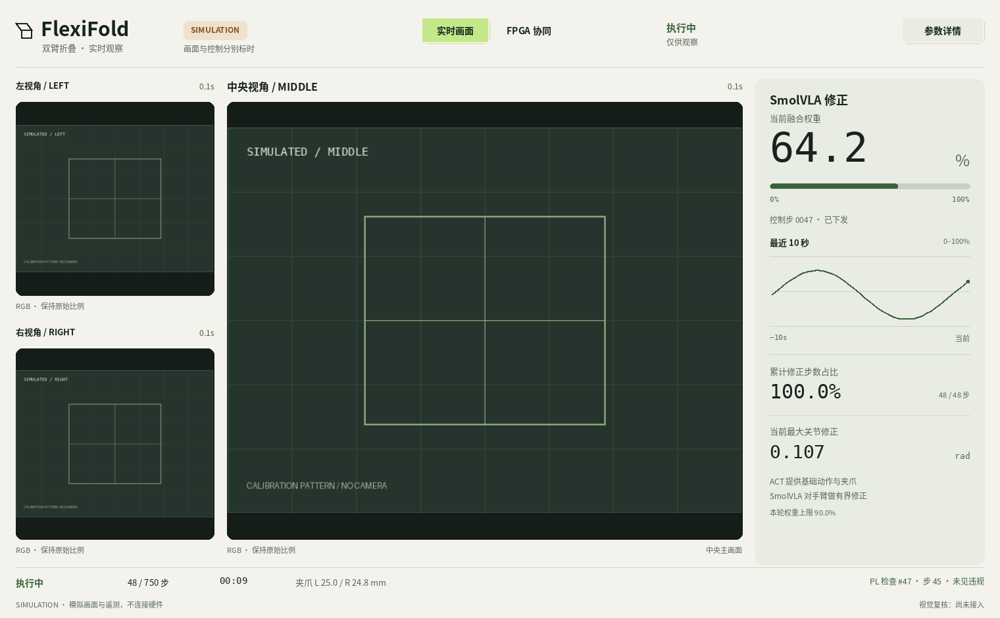
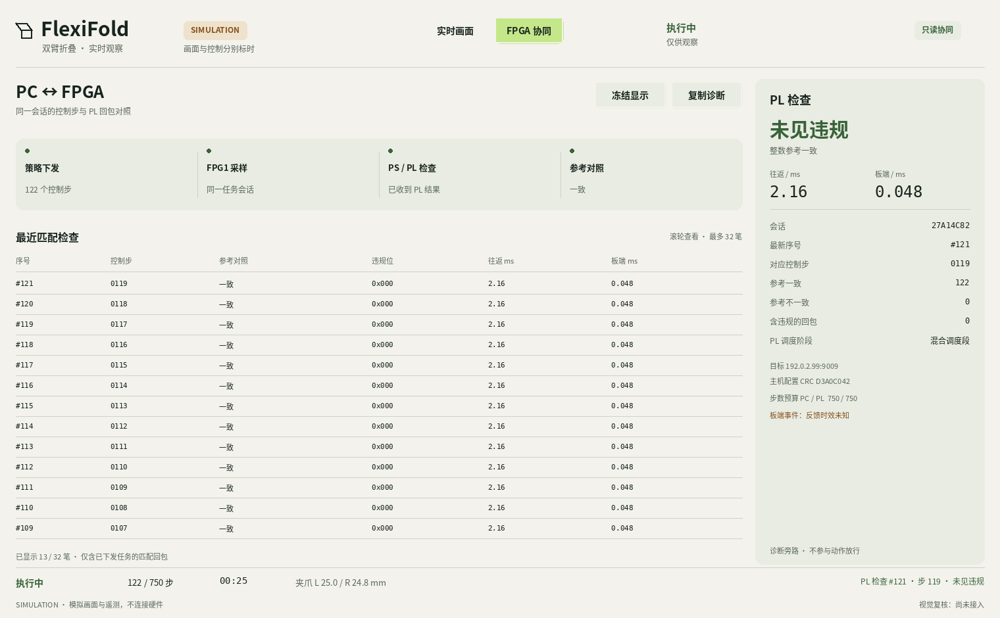
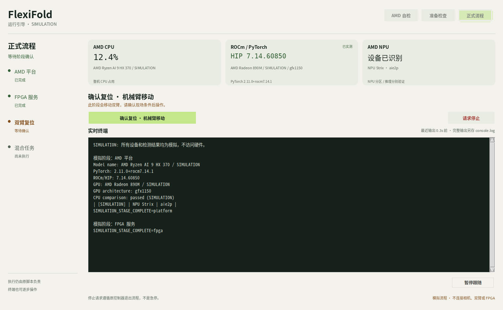

# FlexiFold 实时观察与 FPGA 协同

2026-11-14 板屏状态修正：任务退出发送与本轮 FPG1 SESSION 绑定的 `ENDED/FAILED/STOPPED`，板屏保留“本轮运行已结束／执行中断／已停止”，不再持续显示“等待新数据”。动作规则通过、PL 翻折阶段、脚本返回 0 均不代表物理折叠成功；当前未完成现场视觉标定，结果默认待现场确认。运行引导在结束后提供“现场确认：成功／未完成”两个大按钮，通过匹配会话的 FUI1 回执提交，并保存 `artifacts/task_outcomes/`；来源标为操作员，不计为 PL 视觉判定。旧会话结果不能覆盖新任务。

互动主操作按钮高度 64–68 px，含“查看越界示例”“修正到安全值”“插好了，检查并开始”“结束并保存”，滑块手柄也加大。首次载入或文件变化时自动同步 B35 显示驱动、状态模型、协议与字体；文件一致时复用。等待真实服务启动后才做边界检查，显示初始化先提交完整等待帧，退出显示进程可保留末帧。启动或板屏状态／图片匹配失败时记录板端控制台诊断并尝试恢复任务显示服务；未通过验收不启用互动。

2026-11-14 连续演示更新：运行引导顶栏已加入「仅复位」「互动」，与「准备检查」「运行任务」「AMD 自检」共用同一个 Tk 窗口。任务结束默认保留 FPGA 服务和板屏；只在明确设置 `AIPC_FPGA_AUTO_OFF=1` 时沿用旧的自动停止行为。手动关闭使用 `npu_deploy/fpga_board/control_jupyter.py stop`。

日常运行不再重复完整 AMD 展示。准备及运行入口复用本次开机内通过校验的 NPU 预检日志，逐次核对 ONNX、输入夹具、日志哈希与运行时身份；重启、文件或运行时变化后重新检查。设置 `AIPC_NPU_FORCE_CHECK=1` 可强制重做。每轮仍保留真实 FPGA 启动探针、当前设备身份和控制器自身的姿态检查。

「仅复位」只执行原双臂复位与轨迹记录，不加载模型、不检查 NPU 或 FPGA；移动前仍要求确认并倒计时。点击「互动」自动载入后台 B35 展台服务，在当前窗口显示诊断滑块及采集控件。任务/互动持有同一操作锁，避免同时切换板卡模式；有未保存的采集时要求先结束保存。点击「插好了，检查并开始」后，面板识别独立右主臂 CAN 接口并检查完整动作指令，通过后自动开始采集。合成排练可在独立展台网页使用。

2026-11-13 改版。正式任务仍由 `start_showcase.sh` 的 `--preview` 自动打开 Tk/Pillow 窗口。
界面分为「实时画面」与「FPGA 协同」两页，顶部切换；关闭窗口只关闭展示。





两图均为本机真实 Tk 窗口运行截图，醒目标记 `SIMULATION`；画面是校准图形，遥测也是模拟数据，不是现场运行证据。

## 直接预览

从项目根目录执行，无需相机、机械臂、模型权重或 FPGA：

```bash
./amd_hybrid_deploy_20261031/.venv/bin/python npu_deploy/demo_live_dashboard.py --seconds 60
./amd_hybrid_deploy_20261031/.venv/bin/python npu_deploy/demo_live_dashboard.py --seconds 60 --page fpga --scenario board-ok
```

若系统缺少 Tk，可执行 `bash tools/prepare_dashboard_ui.sh`。脚本将 Ubuntu 24.04 / Python 3.12 的 Tk 包解压到 `.ui-runtime/`，不需要 sudo；窗口优先使用系统 Tk。本机已准备完成。字体继续使用 Noto CJK，中文由 Pillow 绘制。

导出无桌面 PNG：

```bash
./amd_hybrid_deploy_20261031/.venv/bin/python npu_deploy/demo_live_dashboard.py --snapshot /tmp/flexifold.png
./amd_hybrid_deploy_20261031/.venv/bin/python npu_deploy/demo_live_dashboard.py --snapshot /tmp/fpga.png --page fpga --scenario board-warning
```

`--scenario` 还支持 `waiting`、`read-only`、`stale`、`finished`、`error`、`zero`、`dropout`、`board-mismatch`、`board-stale`。`--size 900x640` 可检查窄屏，`--details` 可导出参数展开状态。

## 实时画面

中央主视角保留原图比例，左侧为左、右两个视角，只有展示副本会缩放。窄屏先隐藏侧面视角和曲线，保留中央画面、当前权重、修正覆盖率及修正幅度。每路缺帧独立处理，超过 1.5 秒未取到有效缓存即灰显，其他视角继续。

SmolVLA 侧栏使用本笔控制数据：

| 项目 | 定义 |
| --- | --- |
| 当前融合权重 | `authority × 100%`，一位小数，固定 0–100% 尺度；零值显示 `0.0`，无遥测显示 `--` |
| 最近 10 秒曲线 | 单调时间，约 50 个显示采样点；同一时间戳不重复追加，过长间隔断线 |
| 累计修正步数占比 | 限幅后、最终全局平滑前，12 个手臂关节的最大绝对修正严格大于 `0.0001 rad` 的已下发步数 / 本轮成功下发步数 |
| 当前最大关节修正 | 同一笔限幅后的 `max(abs(correction[ARM]))`，单位 rad |
| 参数详情里的候选采用 | 已下发且 `source == 'SmolVLA'` 的步数，与含衰减修正的步数分别统计 |

计数在 `wrapper.send_action(...)` 正常返回后递增，表示应用层下发成功返回，不代表机械臂已完成动作。复位、结束保持、探针和只读候选不计入实际下发分母。`SAFE` 来源下仍在衰减的修正会计入修正覆盖率。ACT 始终提供基础动作与夹爪；界面不画 ACT/SmolVLA 互补饼图。

真实只读运行标 `READ ONLY`，可以显示候选权重，实际下发占比为 `--`。遥测 1.5 秒未更新会标过期，跟相机时效分开判断；结束状态保留最后读数并标明状态，整个任务包装器退出时窗口仍按原清理流程关闭。

「参数详情」展开 12 关节、夹爪和末端 XYZ / RX / RY / RZ。关节单位 rad，夹爪 mm，末端分别为 mm 和度。位姿来自 SDK 原始坐标系缓存，未经双臂世界坐标系标定；这些数据没有曝光级同步。

## FPGA 协同

页面读取**现有 FpgaShadow 工作线程已经匹配的 FPG1 任务回包**，不会额外开 UDP 会话、发状态探针、重置板端服务或修改密钥。没有本轮匹配回包时显示等待，不补造结果。真实任务仍通过已有 `AIPC_FPGA_SHADOW` 配置启用板端路径。

页面包括：

- 策略下发 → FPG1 采样 → PS/PL 检查 → 整数参考对照的证据状态；收到回包才点亮相应阶段。
- 会话号、回包序号、对应控制步、最新往返耗时、板端处理耗时、PL 调度阶段。
- 参考一致 / 不一致、含违规回包的本轮累计数；累计在工作线程完成，不受显示跳帧影响。
- 最近最多 32 笔匹配检查，滚轮查看历史；窄屏压缩列数，仍保留控制步、结果和往返耗时。
- 主机配置 CRC、PC/PL 步数预算；反馈时效未知等事件明确显示。PL 的 ACT/混合阶段是调度阶段，不表示抓取或折叠成功。

回包按当前任务轮次和会话关联，启动探针、只读样本、旧任务或旧会话结果不会混入当前任务。`FUI1` 状态确认与 `FPG1` 检查分别对待。当前没有实施 FVE1 视觉复核协议，因此不生成 `EVENT # / FRAME #` 或把 PL 结果叠加为当前直播帧的视觉结论。

交互：

| 操作 | 效果 |
| --- | --- |
| 冻结显示 | 固定这一页的控制/回包快照与历史，标 `FROZEN`；后台控制、采样、统计继续 |
| 继续实时 | 恢复显示最新快照 |
| 复制诊断 | 复制当前显示的 JSON：任务、会话、序号、控制步、耗时、违规位、最近检查及是否冻结；不包含相机像素 |
| 滚轮 | 查看最多 32 笔已匹配记录 |

冻结只影响展示，不是暂停任务。该 FPGA 路径是异步诊断旁路，不提供动作放行、安全联锁或急停。

## 快捷键与只读实机入口

`1` / `2` 切换相机与 FPGA 页，`D` 展开/收起参数，`F11` 全屏，`Esc` 退出全屏。FPGA 页 `Ctrl+C` 复制诊断；停止任务仍应在运行终端请求停止。

只观察真实设备（需要先完成现场绑定）：

```bash
bash npu_deploy/run_dashboard_readonly.sh
```

该入口默认运行 20 秒，单独打开三路相机与两臂 CAN；SDK 启动会查询设备信息，不发送使能、复位或运动目标。它不加载模型、不使用 FPGA，使用 4 GiB / 2 核独立 scope。不要与正式任务同时占用设备。

## 实现与验收记录

进程内可选接点为 `shared_runtime/dashboard_telemetry.py`。控制循环只构造小型不可变快照；没有预览订阅时使用空接点，不等待 GUI。相机采样线程把遥测捎带在原有单槽队列中，窗口以约 5 Hz 绘图；横条和曲线使用原生 Tk Canvas。相机页与协同页共用缓存和一套样式，没有新增相机、CAN 或 FPGA 连接。

`task_preview_entry.py` 在运行入口前安装接点、在 finally 恢复，并将新增显示源码纳入任务快照。原动作融合、限幅、平滑、下发与停止逻辑保留。

本机已完成：完整 `npu_deploy/tests` 离线回归 59 项；真实 Tk 窗口的宽屏、900×640、参数按钮、键盘切换、独立遥测过期、FPGA 导航、滚动、冻结/继续和剪贴板诊断验证。最终一轮 137 帧绘制耗时中位数约 14.3 ms，P95 约 18.9 ms；这些是模拟窗口绘制耗时，不是控制循环性能或端到端相机延迟。

复验命令：

```bash
./amd_hybrid_deploy_20261031/.venv/bin/python -m unittest discover -s npu_deploy/tests -v
./amd_hybrid_deploy_20261031/.venv/bin/python npu_deploy/verify_dashboard_ui.py
```

截图及交互报告保存在 `npu_deploy/artifacts/dashboard_ui/`。未验证：真实相机、机械臂、板端联合运行，模型输出与同 step trace 的现场复核，开启显示前后的控制 tick P95/P99。正式动作前仍按原流程确认现场条件。

## 本次界面细节复核

应用 [Impeccable](https://github.com/pbakaus/impeccable/tree/main/.agents/skills/impeccable) 与 [Make Interfaces Feel Better](https://github.com/jakubkrehel/make-interfaces-feel-better/tree/main/skills/make-interfaces-feel-better)。参考 [ITom](https://itomdev.com/)、[Cerebrium](https://cerebrium.ai/)、[MotionSites](https://motionsites.ai/) 的实际页面，取其视觉主次与细节完成度，按桌面操作界面的需要限制装饰和高频动画。

复核模式为 `full`；范围限本次 Tk/Pillow 相机与 FPGA 页面，沿用 Python、Noto CJK 和原有缓存架构。

| 类别 | 已检查证据 | 结果 |
| --- | --- | --- |
| 字体 | 宽窄屏、中文参数、动态百分比与计数 | 中文 Pillow 字体；主要动态数字等宽；固定数值列；主文字对比度实测不低于 5.07∶1 |
| 表面 | 相机原比例、结构分隔、图像边缘、主次区域、参数展开 | 中央主视角；低对比结构线；纯白透明图像轮廓 |
| 动效 | 5 Hz 动态曲线、页切换、冻结、停更 | 不添加装饰动画或数字缓动；状态同时用文字表达；无需慢放检查动画序列 |
| 图标 | 相机空态、折叠标记、按钮 | 自绘统一线条；按钮以明确文字命名；键盘焦点可见 |
| 性能 | 单槽队列、50 点曲线、32 笔检查、真实 Tk 绘制报告 | 有界；主循环无 GUI 回调；实机控制延迟仍待现场比较 |

| 严重性 | 位置 | 改前 | 改后 | 原因 |
| --- | --- | --- | --- | --- |
| MEDIUM | `shared_runtime/camera_preview.py` / `dashboard_view.py` | 三视角等宽、全部关节常驻 | 中央主画面、侧面小窗、可展开参数、窄屏降级 | 信息层次与操作扫描效率 |
| HIGH | `deployment_entry/cobot_hybrid.py` / `dashboard_telemetry.py` | 没有可靠实时修正统计 | 成功下发后累计，同快照数字与曲线，来源/只读分开 | 防止显示跳帧或 SAFE 衰减导致统计误读 |
| HIGH | `dashboard_view.py` | 无模型遥测的独立时效 | 缺失 `--`、真实零值、停更灰显、结束/错误状态 | 防止把陈旧或未知数值当作实时值 |
| HIGH | `npu_deploy/fpga_live_shadow.py` / `dashboard_telemetry.py` | 无板端实时匹配展示 | 当前任务/会话匹配、探针排除、参考与违规分别呈现 | 防止显示错误事件与伪造 PL 通过 |
| MEDIUM | `dashboard_view.py` | 无协同页面操作 | 冻结、复制诊断、滚动历史、切页 | 操作有明确反馈，冻结不暗示控制暂停 |
| MEDIUM | `shared_runtime/dashboard_view.py:82` | 窄屏压缩标题区，副标题贴近分隔线 | 统一标题区高度，增大画面标题与底部信息间距 | 用户截图反馈；保持文字与线条的净空 |
| MEDIUM | `shared_runtime/tk_support.py` / `tools/prepare_dashboard_ui.sh` | 本机缺 Tk 无法打开 | 用户目录内补齐 Tk，正式窗口实测 | 完成功能路径与可复验交付 |

未采用：ACT/SmolVLA 互补饼图（不符合有界叠加语义）；持续背景/数字缓动（分散高频观察注意力）；在监控页新增复位/启停按钮（超出本次显示范围）；FUI1 轮询覆盖任务状态（会创建额外会话并可能改变板端当前状态）。

界面细节结论：`Approve`，仅限已验证的离线与模拟 UI 范围；上述实机与控制延迟检查仍未验证。

## 运行引导面板

运行阶段也可使用同一视觉规范的交互面板。原来的终端入口保留，不加参数时行为不变。

```bash
# 无硬件模拟预览：只运行模拟子进程，不复位或控制设备
./amd_hybrid_deploy_20261031/.venv/bin/python npu_deploy/showcase_panel.py --demo

# 准备检查面板
bash npu_deploy/prepare_showcase.sh --panel

# 正式流程面板：仍须逐阶段确认，复位及正式运行会移动机械臂
bash npu_deploy/start_showcase.sh --panel

# 只验证 AMD 平台，不连接相机、CAN、双臂或 FPGA
./amd_hybrid_deploy_20261031/.venv/bin/python npu_deploy/showcase_panel.py --workflow amd
```



上图为真实 Tk 窗口的模拟流程截图，不是实际执行机械臂的证据。

面板提供准备检查、正式流程和 AMD 自检三种选择；先载入流程，再在每个确认点点击当前阶段按钮。复位与正式运行按钮明确写出会移动机械臂。连续双击不会预存一个 Enter 给下一阶段。失败、停止或退出不会自动跳到后续阶段。

待机时 CPU 型号来自系统只读信息、ROCm/PyTorch 版本来自当前环境的软件包元数据，明确标记 GPU 待实测，不据此宣称校验通过。执行后，CPU、ROCm、NPU 证据来自本轮输出：CPU 型号与整机占用；PyTorch、ROCm/HIP、GPU 名称/架构及 GPU 矩阵对照结果；XRT 识别的 NPU，以及 NPU 子图和实际推理完成的独立状态。没有可靠的 NPU 利用率数据时不生成百分比。正式流程仅检测设备后显示“设备已识别”，直到 `NPU_FIRST_INFERENCE_COMPLETED` 才显示推理完成；不把枚举或 provider 注册当成推理。

AMD 自检使用实际 `lscpu`、原 `demo_rocm_compute.py` 和 AMD 官方 NPU quicktest；成功要求 ROCm 与 CPU 对照通过，以及 quicktest 退出成功、日志包含正数 NPU 子图和 `Test Finished`。它不等于项目模型或机械臂任务验收。

实时终端保留在面板内，也回显到启动面板的原终端；可暂停/继续日志跟随。显示队列和文本行数有界，窗口略过的行数会明确提示，完整子进程输出另存 `npu_deploy/artifacts/launcher/<本轮时间>/console.log`。设备阶段的原始日志仍由原脚本保存。

如果子进程需要终端认证，面板只在 PTY 关闭回显时显示掩码输入框；认证值不由面板写入日志，也可直接在原终端输入。子进程结束后恢复原终端模式。

“请求停止”、原终端 Ctrl+C 和运行中的窗口关闭请求均向原脚本的进程组发送 SIGINT，等待原控制器退出，不自动强杀。关闭运行中窗口会先请求停止并等待退出。停止不是急停，保持姿态/断连语义以原控制器为准。

界面无法初始化时，`--panel` 会在未启动执行子进程前返回原终端流程；已经开始运行的流程不会因为界面故障重新启动一遍。原终端方式始终可以直接使用：`bash npu_deploy/start_showcase.sh`。

实现文件：`showcase_panel.py`（界面）、`showcase_runner.py`（PTY 与有界日志适配）、`check_amd_platform.sh`（无机器人访问的实测）、`showcase_panel_demo.py`（纯模拟 fixture）。开始混合任务时，原脚本仍打开实时相机/FPGA 窗口，引导面板继续显示阶段与日志，不重复连接设备。原两份 shell 只新增可选页面入口和确认点通知；执行顺序、复位完成检查、750 步预算与正式 `--preview` 均保留。

本机已通过真实 AMD 自检：HX 370、PyTorch `2.11.0+rocm7.14.1`、HIP `7.14.60850`、Radeon 890M / `gfx1150`、NPU Strix / `aie2p`，ROCm 对照与官方 NPU 推理均通过。全套 59 项离线测试通过，覆盖逐阶段门控、防双击、进程组停止、无界面回退、认证输入不落日志、TTY 恢复与日志有界。面板模拟实窗逐阶段验证无回调错误；真实相机、双臂、FPGA 与正式完整任务仍需现场联调。
