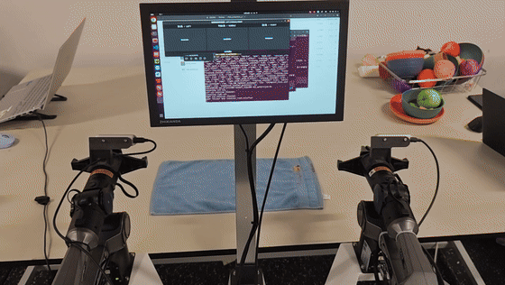
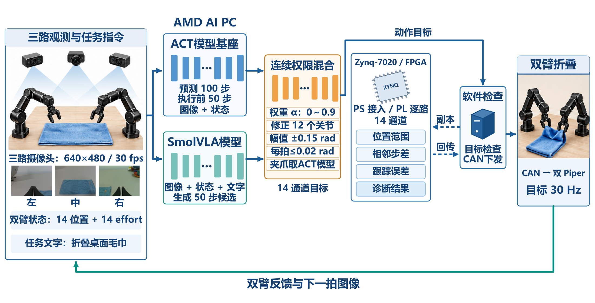
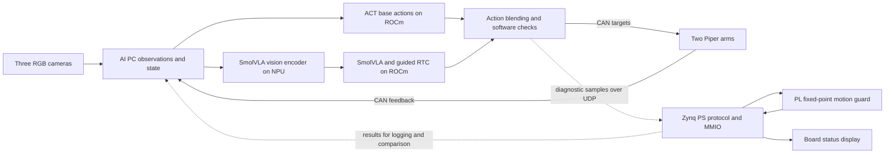
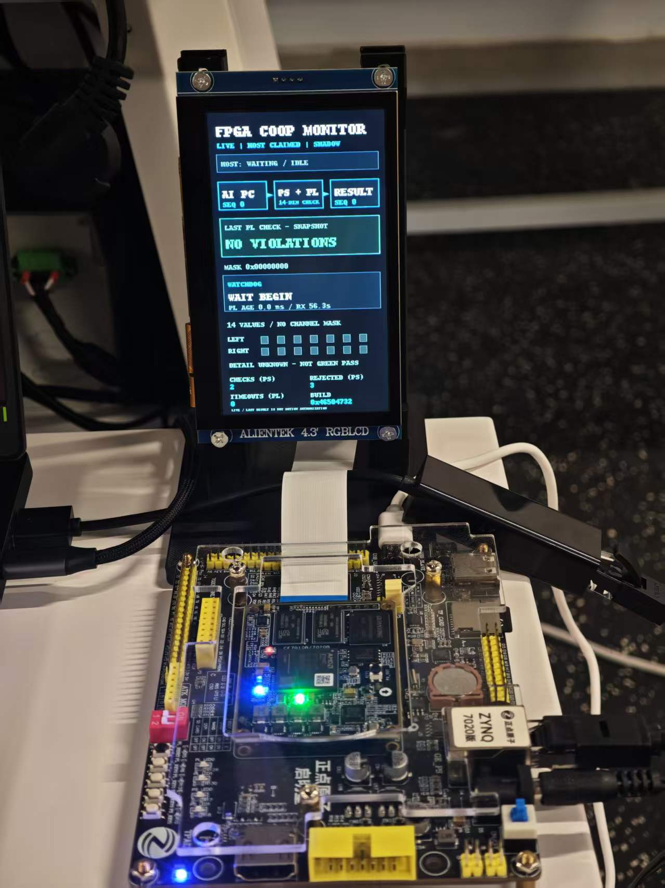

# Bimanual Towel Folding on Ryzen AI and Zynq

[中文](readme_zh.md) | English

We are building a desktop bimanual robot that observes a towel, generates actions, and physically grasps and folds it. Three RGB cameras and two AgileX Piper arms connect to an AMD Ryzen AI PC running a hybrid ACT–SmolVLA policy. In parallel, the host sends copies of actions and feedback over Ethernet to a Zynq-7020. FPGA fixed-point logic checks these samples and the board LCD displays diagnostic status.

The project connects **action generation, physical execution, and hardware observation**. ACT supplies a base action sequence; SmolVLA contributes bounded candidate corrections. The AI PC handles inference, fusion and robot control, while the Zynq provides a separately observable hardware computation path. We are sharing the source, FPGA project, design notes and reproduction entry points for researchers and developers working on robot learning and hardware–software systems.

> **Current scope:** FPGA results are diagnostic only: they do not approve, block or stop robot motion and are not an emergency stop. This is a research and handover snapshot. Trained checkpoints and some raw evidence are not public; task success rate, physical end-to-end latency, and clean-environment reproduction remain to be measured.

## Demonstration



A real robot trial on 2026-10-30, shown at approximately 2× speed. [Watch the full-length silent video](docs/assets/folding_demo.mp4). The team observed that this run substantially completed the fold; 667 control cycles were recorded, and a software limit stopped the subsequent return. This is one demonstration, not a success-rate measurement or evidence that the later FPGA/NPU integration was active in that run.



*Project report diagram with Chinese labels; robot illustrations are schematic. The FPGA receives diagnostic copies, while the AI PC software path issues the robot commands. An English flow diagram appears below.*

## Why this problem

A towel changes shape as it is manipulated. The same motion sequence can produce a different outcome when its initial placement, grasp point, occlusion or gripper state changes. A useful prototype must bring together multiple camera views, bimanual state, action generation and a control schedule, while making the proposed actions and diagnostic checks observable.

Our design combines two trained policies. ACT learns action sequences from demonstrations and supplies a continuing base; SmolVLA generates candidates from images, state and task text. A mixer applies authority, magnitude and rate constraints before using a candidate as an arm correction. Gripper targets stay with ACT. This lets us investigate asynchronous vision-language-action inference while preserving the trained models' input and output contracts.

Perception and action run locally on the AI PC without requiring a cloud request for each control step. This keeps processing at the worksite and places inference alongside robot control. Offline use still depends on provisioning models and software beforehand; we have not measured a clean offline deployment success rate, and local execution alone is not an end-to-end latency result.

## How the system works



1. **Observe:** the host acquires three RealSense RGB streams and joint/gripper feedback, preserving the trained input order and preprocessing.
2. **Decide:** ACT supplies base action chunks; SmolVLA asynchronously proposes corrections through guided RTC. The host mixer applies the existing software constraints.
3. **Act:** the AI PC sends 14-dimensional targets to both arms over USB-CAN and receives feedback. The configured control target is 30 Hz; actual intervals must be measured.
4. **Diagnose:** the host sends samples of targets, feedback, base actions and corrections to Zynq over UDP. The PS handles protocol and MMIO, and PL logic checks fixed-point vectors. Results return to the host and appear on the LCD.

The AI PC and arms form the perception–decision–execution–feedback path. FPGA is an asynchronous observation branch: replies neither gate nor authorize motion, and link failure does not automatically stop the arms. Making FPGA results an actual motion interlock would require a redesigned execution path and fault handling.

## Hardware and recorded environment

| Component | Project setup | Role |
| --- | --- | --- |
| AI PC | ASUS TX Air FA401KM; Ryzen AI 7 H 350; approximately 30 GB visible memory | Capture, inference, blending, UI and scheduling |
| AMD GPU / NPU | Radeon 860M (`gfx1152`); Ryzen AI NPU | ROCm policy computation; experimental NPU vision encoding |
| Arms | 2 × AgileX Piper, each with 6 joints and 1 gripper; separate USB-CAN, 1 Mbps | Physical actuation and feedback |
| Vision | 3 × Intel RealSense 435-series cameras; configured RGB 640×480 at 30 FPS | Left, middle and right views; depth is not claimed as a model input |
| FPGA | Alientek Zynq-7020, `xc7z020clg400-2`, PYNQ | UDP, AXI access, RTL checks and board display |
| Display / link | 800×480 LCD; wired Ethernet between PC and board | Status and diagnostic communication |

The field record lists Ubuntu 26.04, Python 3.12, ROCm 7.14.1, PyTorch `2.11.0+rocm7.14.1`, XRT 2.26.89 and a historical PYNQ 2.7 / Python 3.8 board environment. See the [technical report](docs/technical_report_zh.md) for drivers, firmware and other recorded versions. Consult the [AMD compatibility matrix](https://rocm.docs.amd.com/projects/radeon-ryzen/en/latest/docs/compatibility/compatibility.html) before deployment.

The cameras connect to the AI PC over USB; each arm has its own USB-CAN connection and power supply. The Zynq uses wired Ethernet and the LCD connects to the board display interface. A real setup requires verification of power, pinout, cabling and an independent emergency stop. A complete wiring diagram, mechanical drawings and BOM are not yet provided. Hardware serial numbers in the public configuration are placeholders and must be rebound to the actual devices.

## ACT, SmolVLA and asynchronous inference

Inputs comprise three images and a 28-dimensional state: positions and efforts for six joints and one gripper on each side. The output has 14 targets: six joints and one gripper for each arm. Joint targets are in radians and gripper positions in meters. Feature ordering, normalization and color-channel handling follow the training configuration.

| Module | Project configuration and role |
| --- | --- |
| ACT | Project-trained `act050000`; chunk size 100, `n_action_steps=50`; supplies base actions and gripper targets |
| SmolVLA | Project-trained `smol030000`; chunk size 50, 10 denoising steps; proposes arm corrections |
| guided RTC | Asynchronous candidate generation; guidance weight 2.5, execution horizon 10, default handoff logic at step 300 |
| Mixer | Applies trust, magnitude and rate constraints; grippers remain under ACT ownership |
| NPU vision subgraph | ONNX input `[1,3,512,512]`, output `[1,64,960]`; recorded export float32, opset 17 |

The SmolVLA vision encoder runs in a separate NPU worker; the host retains ROCm/PyTorch policy execution and guided RTC autograd. `NPU_FIRST_INFERENCE_COMPLETED` in the field log records at least one completed vision inference. It does not mean the full SmolVLA model or robot control loop ran on the NPU.

After warm-up, three repeats of one fixed observation took **1.157–1.184 s** on the original ROCm guided path and **0.745–0.751 s** on the NPU-vision + ROCm path. This small fixed-input comparison does not establish multi-scenario tail latency or whole-system throughput. We also explored a FastFlowLM non-guided forward path, but it did not cover this project's guided RTC autograd and is not the current full-control replacement. See the [NPU experiment notes](npu_deploy/readme.md).

## Zynq: observable checks in hardware

The Zynq PS handles UDP, CRC and session checks, AXI MMIO, logging and the LCD. The PL implements a fixed-point `motion_guard`, an independent watchdog and LCD framebuffer logic. PYNQ provides the software interface; the checks themselves run in the Overlay hardware rather than using the board solely as a serial or network adapter.

Each sample carries six `int32[14]` vectors: target, measured state, previous target, ACT base action, correction and previous correction. Angles and gripper positions are multiplied by 1,000,000 in their respective units. Checks cover ranges, joint step and tracking differences, correction magnitude and slew, gripper ownership and profile identity; violation and event bits are returned. Feedback-age checking is disabled in the reported profile, and fixed-point versus float boundaries require dedicated comparison.

| LCD + guard implementation | Build report |
| --- | ---: |
| LUT / FF | 6,357 / 9,379 |
| BRAM / DSP | 96 tiles / 1 |
| Clock constraints | 50 MHz logic; 25 MHz LCD pixel clock |
| WNS / TNS | +4.616 ns / 0 ns |

These values come from the included [utilization](fpga_integration/fpga_code/fpga_workspace/overlay/lcd_framebuffer_20261101/utilization.txt) and [timing](fpga_integration/fpga_code/fpga_workspace/overlay/lcd_framebuffer_20261101/timing_summary.txt) reports. Board-call timing and integer-reference agreement have been recorded. A same-input CPU baseline and isolated PL-core latency are still missing, so we do not claim a specific speedup or that hardware is irreplaceable on that evidence alone.



*The LCD shows one diagnostic snapshot; a normal-looking display does not establish robot safety or task success.*

## Communication, timing and failure handling

The host and board use wired Ethernet/UDP. The little-endian `FPG1` protocol uses 392-byte requests and 48-byte responses. The header includes version, session, sequence and a host monotonic timestamp; CRC32 detects transmission errors. Replies contain profile identity, violation and event bits, nominal phase and board-call time. See the [protocol and register documentation](fpga_integration/fpga_code/fpga_workspace/docs/protocol.md). CRC is not authentication or encryption.

The host uses a bounded asynchronous queue. Drops, full queues, timeouts and board exits are recorded, but currently do not stop the robot. A separate lifecycle service can start and finish the diagnostic/display process and uses HMAC for its management channel. Generate deployment keys on the devices and keep them out of Git. Forced termination or network loss can prevent the finish request from arriving.

Host RTT is measured on the AI PC; board processing uses the board's own clock. The two devices have no verified common clock, and the cameras do not have hardware-synchronized exposure. RTT, adjacent control tick intervals and board-call time cannot be substituted for the physical sensor-to-actuator response latency.

## Results and what they mean

The experiments below are distinct. Summaries for the later 750-step run come from field-machine logs that are not in the public repository, so readers cannot yet independently recompute them from this clone. See the [metrics table](metrics/metrics.csv) and [technical report](docs/technical_report_zh.md) for measurement definitions.

| Measurement | Result and conditions | Interpretation |
| --- | --- | --- |
| One physical demonstration | 667 control cycles; the team observed a substantially completed fold; software limit triggered on return | The video above shows one trial, not a multi-trial success rate |
| Separate control execution | `execute=True`, 750 steps, 26.907 s | Ended at the action budget; the physical outcome was not independently labelled for that run |
| Control tick intervals | P50 / P95 / P99 / max: 33.398 / 33.435 / 139.451 / 406.724 ms, 749 intervals | Adjacent host ticks, not physical end-to-end response |
| FPGA diagnostic RTT | P50 / P95 / P99 / max: 4.644 / 5.313 / 7.175 / 25.537 ms, 750 samples | Includes host, network, PS, AXI and PL |
| Board-call time | P50 / P95 / P99 / max: 2.128 / 2.286 / 2.512 / 5.011 ms, 750 samples | Includes PS/MMIO/PL, not isolated RTL core latency |
| Replies and reference | 751/751 requests replied, including a probe; 750/750 task samples matched an integer software reference | One run; agreement is not robot safety certification |
| FPGA utilization / timing | 6,357 LUTs, 96 BRAM tiles, +4.616 ns WNS | One combined Overlay implementation |

Next we need repeated trials with predefined success, failure and intervention criteria; physical capture-to-actuation P50/P95/P99/max; separate preprocessing, inference, postprocessing and total perception times; and controlled software/hardware baselines, sustained communication, loss, reliability and power tests. Each measurement should record hardware, model precision, input, software, clocks, power mode, sample count and reviewable logs or waveforms. Until measured, missing results remain unreported rather than being treated as zero or assumed compliant.

## Using and reproducing the project

Code and FPGA build outputs are available, but the trained checkpoints, exported NPU model, drivers, private keys and most field raw data are not included. A clone alone therefore **cannot currently reproduce the complete physical task**. Before real motion, check the workspace, power, limits and an independent physical emergency stop. Reset and policy scripts can move the arms; Ctrl+C and the FPGA display are not emergency stops.

1. Assemble the arms, cameras, AI PC and Zynq according to the hardware inventory. Follow [technical report §11](docs/technical_report_zh.md) to prepare compatible Linux, ROCm, Ryzen AI, XRT, Piper SDK and PYNQ environments.
2. Restore the project's own ACT / SmolVLA checkpoints, processors and matching NPU ONNX assets and verify their identities as described in the report. The trained checkpoints cannot be recovered automatically from the public base model.
3. Replace placeholder device identities in `amd_hybrid_deploy_20261031/piper_towel_replica/configs/cobot_site.json`; adapt paths and IPs, then verify camera roles, CAN bindings and board bitstream. Do not assume historical device numbers match your system.
4. Read the [showcase guide](npu_deploy/showcase_guide_zh.md), [FPGA protocol](fpga_integration/fpga_code/fpga_workspace/docs/protocol.md) and [board runbook](fpga_integration/fpga_code/fpga_workspace/docs/runbook.md). Begin with no-motion command checks:

```bash
bash npu_deploy/prepare_showcase.sh --check-only
bash npu_deploy/start_showcase.sh --check-only
bash npu_deploy/run_dashboard_readonly.sh --check-only
```

5. After simulation, read-only checks and physical safety preparation, follow the guide for board integration, reset and real operation. Record test conditions and logs; compare the images, actions and recorded results.

The supplied [dashboard image](docs/assets/dashboard_demo.png) is a simulated preview. Complete field acceptance of the new UI with all three real cameras remains outstanding. Scripts still contain site-specific paths and environment assumptions; cross-device migration and clean-install time have not been independently demonstrated.

## Repository and reusable workflows

| Directory | Contents |
| --- | --- |
| [`npu_deploy/`](npu_deploy/) | NPU integration, device checks, showcase, read-only UI and FPGA clients |
| [`amd_hybrid_deploy_20261031/`](amd_hybrid_deploy_20261031/) | Policy/control, deployment configuration, dependencies and licensed reference code |
| [`fpga_integration/fpga_code/fpga_workspace/`](fpga_integration/fpga_code/fpga_workspace/) | RTL, testbenches, Vivado TCL, Overlay and implementation reports |
| [`fpga_integration/board_runtime/`](fpga_integration/board_runtime/) | Board runtime, display and session fixes |
| [`metrics/`](metrics/) / [`tools/`](tools/) | Summaries and log aggregation script; raw field logs are not public |
| [`skill/`](skill/) | Preparation, diagnostics, UI and offline comparison workflows, with scope and limitations |
| [`docs/`](docs/) | Technical reports, interface notes, visuals and the original track requirements |

These directories correspond to the host, FPGA, metrics, skill and report areas in a conventional submission layout. Workflows are packaged, but migration to another machine or task without modification has not been demonstrated.

## References and licensing

The project draws on [LeRobot](https://github.com/huggingface/lerobot), the [ACT paper](https://arxiv.org/abs/2304.13705), [SmolVLA documentation](https://huggingface.co/docs/lerobot/smolvla), and the [SmolVLM2 model card](https://huggingface.co/HuggingFaceTB/SmolVLM2-500M-Video-Instruct). Platform references include the [Piper SDK](https://github.com/agilexrobotics/piper_sdk), [AMD Ryzen AI](https://ryzenai.docs.amd.com/en/latest/), [ROCm](https://rocm.docs.amd.com/projects/radeon-ryzen/en/latest/), and [PYNQ](https://pynq.readthedocs.io/en/latest/).

Project-authored source is released under [Apache-2.0](license). Third-party files retain their own licenses and [notices](amd_hybrid_deploy_20261031/third_party_notices.md); models, hardware dependencies and external downloads have their own terms. The [public release checks](docs/public_release_checks.md) describe the checks performed and remaining gaps.
