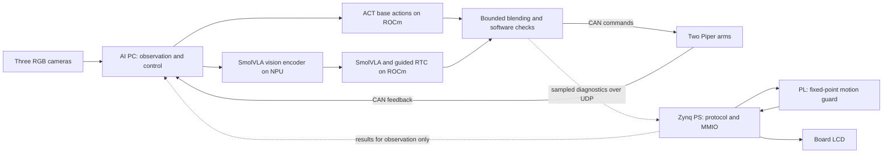

# Bimanual Embodied AI on Ryzen AI and Zynq

[中文](readme_zh.md) | English

A research prototype for bimanual towel manipulation using two AgileX Piper arms, three RGB cameras, an AMD Ryzen AI PC, and a Zynq-7020 FPGA. An ACT policy supplies base action chunks; SmolVLA adds bounded arm corrections through an asynchronous guided RTC path. A separate NPU worker runs the SmolVLA vision encoder while the remaining policy and control run on the ROCm/PyTorch path.

**Status: research prototype, not a safety system or a completed competition submission.** The FPGA is an asynchronous diagnostic side channel: it checks sampled actions and feedback and returns results for logging/display. It does **not** approve, block or stop robot motion. The current communication failure path does not stop the robot. A 750-step execution is not proof that the towel was folded successfully.

*Board photograph: the displayed snapshot does not establish robot safety or successful task execution.*

## Architecture

The execution and diagnostic paths are different; no hardware interlock between them is claimed. See [technical report, English](docs/technical_report_en.md), [Chinese technical report](docs/technical_report_zh.md), [FPGA protocol](fpga_integration/fpga_code/fpga_workspace/docs/protocol.md), and [competition requirements](docs/track_requirements.md).

## Evidence at a glance

| Observation | Scope and limitation |
| --- | --- |
| 750 control steps with `execute=True` | One recorded run ended at its action budget; physical task success was not independently labelled. |
| 750/750 FPGA task samples matched an integer software reference; 0/751 request timeouts | One run; includes one probe. The original logs are not in this repository. |
| FPGA round-trip P50/P95/P99/max: 4.644/5.313/7.175/25.537 ms | 750 samples over wired UDP, includes host, network, PS and hardware processing; not end-to-end physical response time. |
| LCD + guard implementation: 6,357 LUT, 96 BRAM tiles, WNS 4.616 ns | Build reports are included; hardware configuration and clock constraints matter. |

See [metrics](metrics/metrics.csv) and [measurement notes](metrics/readme.md). Unmeasured success rate, physical response latency, AI task quality, and other missing competition evidence are not zero or validated results. Raw field logs and trained weights are not distributed here.

## Repository guide

| Directory | Contents / competition counterpart |
| --- | --- |
| `npu_deploy/` | AI PC NPU integration, diagnostics, and execution scripts (host) |
| `amd_hybrid_deploy_20261031/` | Control, deployment, configurations, vendored LeRobot and ACT references (host/model/deploy) |
| `fpga_integration/fpga_code/fpga_workspace/` | RTL, testbenches, Vivado TCL, bit/HWH and implementation reports (FPGA) |
| `fpga_integration/board_runtime/` | Board runtime, overlay and session fix |
| `docs/` | System details, track requirements, screenshots and photograph |
| `metrics/`, `tools/` | Summary table and aggregation script; no raw telemetry |
| `skill/` | Reusable workflows and their validation limits |

## Getting started and reproduction limits

1. Review the hardware/software inventory and setup in [technical report §3 and §11](docs/technical_report_zh.md). The field system used Ubuntu, Python 3.12, ROCm 7.14.1, and a PYNQ Zynq-7020. Check your specific AMD hardware/OS against the [official compatibility matrix](https://rocm.docs.amd.com/projects/radeon-ryzen/en/latest/docs/compatibility/compatibility.html).
2. Restore the project's trained ACT and SmolVLA checkpoints, compatible processors, drivers and model assets separately. They are **not included**, so a fresh-clone end-to-end reproduction cannot currently be guaranteed. Follow the detailed paths and notes in the report; local paths and IPs are examples; hardware serial numbers in `cobot_site.json` have been replaced with placeholders and must be filled from the actual devices.
3. Start with read-only device inventory and synthetic FPGA checks described in [showcase guide](npu_deploy/showcase_guide_zh.md) and [FPGA documentation](fpga_integration/fpga_code/fpga_workspace/docs/). Some historical documentation describes earlier development states; the [technical report](docs/technical_report_zh.md) records the later integrated state.
4. Review the physical workspace, device binding, limits, independent emergency stop and connection setup before any real motion. Reset and policy scripts can move both arms. Ctrl+C and FPGA display are not emergency stops.
5. Record new experiment conditions and raw evidence privately, then publish only material cleared for release. Evaluate task success with a defined independent criterion and measure sensor-to-physical-response latency separately.

This repository is a code and documentation snapshot; it does not yet contain all artifacts required for the competition submission or a verified clean-environment setup. See [verification notes](docs/verification_zh.md) and [English technical overview](docs/technical_report_en.md).

## References

- [LeRobot](https://github.com/huggingface/lerobot) and [ACT documentation](https://huggingface.co/docs/lerobot/act); vendored materials retain their own notices.
- [ACT: Learning Fine-Grained Bimanual Manipulation with Low-Cost Hardware](https://arxiv.org/abs/2304.13705).
- [SmolVLA](https://huggingface.co/docs/lerobot/smolvla) and [SmolVLM2 model card](https://huggingface.co/HuggingFaceTB/SmolVLM2-500M-Video-Instruct).
- [AMD Ryzen AI Software](https://ryzenai.docs.amd.com/en/latest/), [ROCm on Radeon and Ryzen](https://rocm.docs.amd.com/projects/radeon-ryzen/en/latest/) and [PYNQ documentation](https://pynq.readthedocs.io/en/latest/).
- [AgileX Piper SDK](https://github.com/agilexrobotics/piper_sdk).

## Licensing

Project-authored source is made available under Apache-2.0; third-party components retain their own licenses and notices. Model weights, hardware/board dependencies and external downloads have their own terms. See [third-party notices](amd_hybrid_deploy_20261031/third_party_notices.md). Hardware build artifacts and data/configuration are subject to their stated provenance and licensing.
