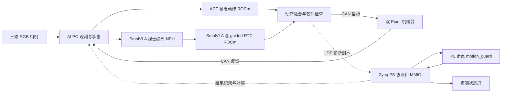

# 双臂折叠毛巾：基于 Ryzen AI 与 Zynq 的具身智能系统

中文 | [English](readme.md)

我们希望让一套桌面级双臂机器人完成从观察毛巾、生成动作到实际抓取和折叠的完整过程。系统使用三路 RGB 相机与两只 AgileX Piper 机械臂，在 AMD Ryzen AI PC 上运行 ACT 与 SmolVLA 混合策略，同时通过以太网将动作和反馈的副本发送给 Zynq-7020，由 FPGA 的定点硬件检查逻辑进行旁路诊断，并在板端 LCD 上展示状态。

项目的核心思路是把**动作生成、实际执行与硬件观测**连接起来：ACT 为熟悉的操作提供动作基座，SmolVLA 提供受约束的候选修正；AI PC 负责模型推理、融合及机器人控制，Zynq 则承担可独立检查的硬件计算。我们公开源码、FPGA 工程、设计记录和复现入口，供机器人学习与软硬件协同方向的开发者参考。

> **当前边界：**FPGA 检查结果用于诊断和记录，不决定机械臂是否执行动作，也不承担急停功能。仓库是一份研究原型及交接快照：训练模型和部分原始证据未公开，完整成功率、物理端到端时延和干净环境复现仍需补测。

## 实机演示


2026 年 10 月 30 日的一次现场演示，动图约 2 倍速。[观看完整静音视频](docs/assets/folding_demo.mp4)。根据团队观察，这次运行基本完成了折叠；记录包含 667 个控制周期，随后回位阶段触发软件限位而停止。视频展示单次任务过程，不能据此计算成功率，也不能证明后续 FPGA/NPU 集成已在这一轮运行中生效。


*项目整体结构：机械臂效果图为示意；FPGA 接收诊断副本，实际动作由 AI PC 的软件控制路径下发。*

## 我们在解决什么问题

柔性毛巾没有固定形状。同一条动作轨迹可能因为初始摆放、抓取点、遮挡或夹爪状态不同而得到不同结果。系统需要同时处理三路视觉信息、两只机械臂状态、动作生成与控制节奏，还要让开发者看清楚候选动作和硬件检查到底发生了什么。

我们的选择是将已训练的 ACT 与 SmolVLA 组合：ACT 从示教数据中学习动作序列，为任务提供持续的基础动作；SmolVLA 结合图像、状态和任务文字生成候选，经过权限、幅值及变化率限制后对手臂目标进行修正。夹爪目标保留在 ACT 路径。这样可以在保留已有模型及其输入输出约定的基础上，探索异步视觉语言动作模型如何参与双臂操作。

AI PC 在本地处理感知和动作，不需要把每个控制步骤交给云端；这有利于数据留在现场，并让推理与机器人控制在同一台机器上协作。离线可用性仍取决于事先准备好模型、依赖和环境；我们目前没有完整的离线部署成功率测量，也不把本地部署直接等同于已测得的端到端加速。

## 系统如何工作



1. **观察：**三路 RealSense RGB 图像与双臂关节、夹爪反馈进入 AI PC；系统按训练时的输入顺序和预处理构造观测。
2. **决策：**ACT 输出基础动作块，SmolVLA 以异步 guided RTC 的方式产生候选修正；融合器检查候选是否满足现有软件约束。
3. **执行：**AI PC 经 USB-CAN 将 14 维目标发送给两只机械臂，并接收反馈；控制目标为 30 Hz，实际周期需以日志测量。
4. **诊断：**主机将目标、反馈、基础动作与修正量的采样副本通过 UDP 发给 Zynq。PS 处理报文，PL 检查固定点向量，结果返回主机并显示在 LCD 上。

主机和机械臂构成感知—决策—执行—反馈链。FPGA 是这条链路的异步观测支路：当前回包不阻塞、授权或拒绝动作，通信中断也不会自动停臂。将其升级为实际动作门控需要重新设计控制路径和故障处理，不能只修改界面上的状态。

## 设备与运行环境

| 组成 | 本项目记录 | 主要职责 |
| --- | --- | --- |
| AI PC | ASUS TX Air FA401KM；Ryzen AI 7 H 350；约 30 GB 可见内存 | 采集、推理、融合、上位机和调度 |
| AMD GPU / NPU | Radeon 860M（`gfx1152`）；Ryzen AI NPU | ROCm 策略计算；实验性 NPU 视觉编码 |
| 机械臂 | 2 × AgileX Piper；各 6 关节与 1 夹爪；独立 USB-CAN，1 Mbps | 双臂物理执行与状态反馈 |
| 视觉 | 3 × Intel RealSense 435 系列；配置 RGB 640×480、30 FPS | 左、中、右视角；当前不把深度数据作为模型输入 |
| FPGA | 正点原子启明星 V2，Zynq-7020 / `xc7z020clg400-2`，PYNQ | UDP、AXI 访问、RTL 检查与板端显示 |
| 显示与网络 | 800×480 LCD；PC–板卡有线以太网 | 状态展示及诊断通信 |

现场软件记录为 Ubuntu 26.04、Python 3.12、ROCm 7.14.1、PyTorch `2.11.0+rocm7.14.1`、XRT 2.26.89；板端历史环境为 PYNQ 2.7 / Python 3.8。驱动、固件、ONNX 和其他细节见[技术报告](docs/technical_report_zh.md)。这些是现场记录，不表示所有同型号系统都已验证兼容；部署前请查阅 [AMD 兼容性矩阵](https://rocm.docs.amd.com/projects/radeon-ryzen/en/latest/docs/compatibility/compatibility.html)。

三路相机通过 USB 连接 AI PC，两只机械臂各自连接 USB-CAN 和独立电源，Zynq 板通过有线网络连接 AI PC，LCD 接板端显示接口。实际搭建还需核对电源规格、接口引脚、线序和急停；公开包尚未提供完整接线图、机械图纸和 BOM。配置中的设备序列号已改为占位符，必须根据自己的硬件重新绑定。

## ACT、SmolVLA 与异步推理

模型输入包含三路图像和 28 维双臂状态：左右各 6 个关节和 1 个夹爪的位置与 effort。输出为 14 维目标：左、右各 6 个关节和 1 个夹爪。关节使用弧度，夹爪使用米。数据顺序、归一化和颜色通道遵循训练时的配置，而不是由部署脚本随意重排。

| 模块 | 项目配置与作用 |
| --- | --- |
| ACT | 自训练 `act050000`；动作块 100 步、`n_action_steps=50`，负责基础动作及夹爪目标 |
| SmolVLA | 自训练 `smol030000`；动作块 50 步、10 步去噪，生成候选手臂修正 |
| guided RTC | 异步生成候选；配置 guidance weight 2.5、execution horizon 10，默认第 300 步进入接管逻辑 |
| 动作融合 | 对候选实施信任条件、幅值及变化率约束；夹爪仍由 ACT 提供 |
| NPU 视觉子图 | ONNX 输入 `[1,3,512,512]`，输出 `[1,64,960]`；导出记录为 float32、opset 17 |

我们将 SmolVLA 的视觉编码器放在独立 NPU 工作进程，主进程保留 ROCm/PyTorch 策略和 guided RTC 的自动求导。运行日志中 `NPU_FIRST_INFERENCE_COMPLETED` 表示至少一次视觉推理完成；这不意味着整个 SmolVLA 或整个控制回路都在 NPU 上运行。

同一固定观测预热后各测 3 次，原 ROCm guided 路径为 **1.157–1.184 s**，NPU 视觉编码 + ROCm 路径为 **0.745–0.751 s**。这组结果说明在该输入和测试条件下两条路径的表现，样本量很小，不能外推成多场景的尾延迟或整机吞吐。我们也探索过 FastFlowLM 的非 guided 前向，但它未覆盖项目的 guided RTC 自动求导，因此没有把它作为当前完整控制路径的替代方案。详见 [NPU 实验说明](npu_deploy/readme.md)。

## Zynq：让动作检查有可观察的硬件实现

Zynq 的 PS 端处理 UDP 接收、CRC、会话校验、AXI MMIO、日志和 LCD；PL 端实现 `motion_guard` 固定点检查、独立 watchdog 和 LCD 帧缓冲等 RTL。PYNQ 是调用接口，实际检查由 Overlay 中的硬件逻辑执行，而不是仅把板卡当作串口或网络转接器。

每个诊断样本包含六组 `int32[14]`：当前目标、测量值、上一次目标、ACT 基础动作、当前修正和上一次修正。角度与夹爪位置按各自单位乘以 1,000,000 量化。检查包括目标范围、关节单步变化、跟踪差值、修正幅度与变化率、夹爪权限及 profile 一致性；结果使用违规位和事件位返回。当前 profile 的反馈年龄检查关闭；临界值附近需要单独比较定点与浮点的边界行为。

| LCD + guard 联合实现 | 构建报告 |
| --- | ---: |
| LUT / FF | 6,357 / 9,379 |
| BRAM / DSP | 96 tiles / 1 |
| 时钟约束 | 逻辑 50 MHz；LCD 像素 25 MHz |
| WNS / TNS | +4.616 ns / 0 ns |

这些数据来自[资源报告](fpga_integration/fpga_code/fpga_workspace/overlay/lcd_framebuffer_20261101/utilization.txt)和[时序报告](fpga_integration/fpga_code/fpga_workspace/overlay/lcd_framebuffer_20261101/timing_summary.txt)。目前已有板端调用耗时和软件整数参考一致性数据；尚缺同条件 CPU 基线与纯 PL 核心延迟，不能据此声称特定加速倍数或证明硬件方案不可替代。


*LCD 显示一次诊断快照；显示正常不等于机器人处于安全状态或任务成功。*

## 通信、时间同步与异常处理

PC 与 FPGA 使用有线以太网和 UDP；诊断协议 `FPG1` 采用小端序，请求 392 B、响应 48 B。帧头包含版本、会话号、序号和主机单调时钟 tick，CRC32 用于检测传输损坏。响应包含 profile 标识、违规位、事件位、名义阶段和板端调用耗时；字段与寄存器定义见[协议文档](fpga_integration/fpga_code/fpga_workspace/docs/protocol.md)。CRC 不提供身份认证或加密。

主机通过有界队列异步发送，丢包、队列满、超时或板端退出会被记录，但当前不会触发机械臂停机。独立生命周期服务可启动或结束诊断与显示进程，其控制通道使用 HMAC；密钥应在各自设备上生成，不能提交仓库。强制杀进程或网络中断时，结束请求可能无法送达。

主机 RTT 在同一台 AI PC 上测量；板端处理耗时使用板端本地时钟。两端目前没有经过验证的统一时钟，三路摄像头也没有硬件曝光同步。因此 RTT、相邻控制 tick 和板端处理耗时都不能当作“从相机采集到机械臂实际响应”的物理端到端时延。

## 测量结果与现阶段理解

下表将不同实验分开呈现。最新 750 步运行的汇总来自项目原机日志；原始日志未随公开仓库提供，读者暂时不能从本仓库独立重算。完整口径见 [指标表](metrics/metrics.csv) 与[技术报告](docs/technical_report_zh.md)。

| 测量 | 结果与条件 | 如何理解 |
| --- | --- | --- |
| 单次实机演示 | 667 个控制周期；团队观察基本完成折叠，回位时触发软件限位 | 对应上方视频；不是多次试验的成功率 |
| 另一轮控制执行 | `execute=True`，750 步，26.907 s | 以动作预算结束；该轮缺少独立任务结果标注 |
| 控制 tick 间隔 | P50 / P95 / P99 / 最大值：33.398 / 33.435 / 139.451 / 406.724 ms，749 个间隔 | 主机相邻 tick，非物理端到端响应 |
| FPGA 诊断往返 | P50 / P95 / P99 / 最大值：4.644 / 5.313 / 7.175 / 25.537 ms，750 个样本 | 包含主机、网络、PS、AXI 和 PL |
| 板端调用耗时 | P50 / P95 / P99 / 最大值：2.128 / 2.286 / 2.512 / 5.011 ms，750 个样本 | 包含 PS/MMIO/PL；不是纯 RTL 核心延迟 |
| 请求与参考对照 | 751/751 请求收到回复（含一次探针）；750/750 任务样本与整数软件参考一致 | 一次运行；一致不等于动作安全认证 |
| FPGA 资源与时序 | LUT 6,357、BRAM 96、WNS +4.616 ns | 联合 Overlay 的一次实现报告 |

下一步要用事先定义的成功、失败与人工干预判据开展重复试验；测量从相机采集到执行器实际响应的 P50/P95/P99/最大值；拆分预处理、模型推理、后处理和总感知时间；补充同条件软件/硬件对照、持续通信、丢包、可靠性和功耗。每项实验都应记录硬件、模型精度、输入、软件、时钟、功耗模式与测试次数，并保留可复核的日志或波形。现阶段没有这些数据时，我们保留“待测”，不填零或推断达标。

## 实际使用与复现

项目代码和 FPGA 构建产物已公开，但自训练权重、NPU 导出模型、驱动、私有密钥和大部分现场原始数据未包含；因此目前**不能保证克隆后即可从零复现完整任务**。执行真实动作前，请先确认机器人工作空间、电源、限位和独立物理急停。复位和策略脚本会移动机械臂；Ctrl+C 和 FPGA 屏幕都不是急停。

1. 参考上方设备清单，搭建双臂、相机、AI PC 与 Zynq，并确认各自电源及网络；根据[技术报告第 11 节](docs/technical_report_zh.md)准备兼容 Linux、ROCm、Ryzen AI、XRT、Piper SDK 和 PYNQ 环境。
2. 自行恢复项目的 ACT / SmolVLA checkpoint、处理器及相匹配的 NPU ONNX 等资产，按报告核对文件身份；这些训练权重不能从公开底座自动还原。
3. 修改 `amd_hybrid_deploy_20261031/piper_towel_replica/configs/cobot_site.json` 中的设备身份及实际路径、IP，核对相机角色、CAN 绑定和板卡位流；不要照搬历史设备编号。
4. 阅读 [展示指南](npu_deploy/showcase_guide_zh.md)、[FPGA 协议](fpga_integration/fpga_code/fpga_workspace/docs/protocol.md)和[板端运行说明](fpga_integration/fpga_code/fpga_workspace/docs/runbook.md)，先做无动作检查：

```bash
bash npu_deploy/prepare_showcase.sh --check-only
bash npu_deploy/start_showcase.sh --check-only
bash npu_deploy/run_dashboard_readonly.sh --check-only
```

5. 完成模拟、只读检查和现场安全布置后，再按指南逐步进行板端联调、复位和真实任务。保存测试条件与日志，检查画面、动作与记录是否一致。

[界面截图](docs/assets/dashboard_demo.png)是模拟预览；真实三路摄像头和新版界面的完整现场验收仍待补充。现有脚本仍含现场路径和环境假设；跨设备迁移及全新环境部署时间尚未独立验证。

## 仓库导览与可复用流程

| 目录 | 内容 |
| --- | --- |
| [`npu_deploy/`](npu_deploy/) | NPU 集成、设备检查、展示、只读界面及 FPGA 客户端 |
| [`amd_hybrid_deploy_20261031/`](amd_hybrid_deploy_20261031/) | 模型控制、部署配置、依赖及保留原许可的参考代码 |
| [`fpga_integration/fpga_code/fpga_workspace/`](fpga_integration/fpga_code/fpga_workspace/) | RTL、testbench、Vivado TCL、Overlay 和实现报告 |
| [`fpga_integration/board_runtime/`](fpga_integration/board_runtime/) | 板端运行程序、显示与会话修正 |
| [`metrics/`](metrics/) / [`tools/`](tools/) | 指标汇总与原始日志汇总脚本；原始日志未公开 |
| [`skill/`](skill/) | 部署准备、诊断、界面与离线对照流程及其适用限制 |
| [`docs/`](docs/) | 技术报告、接口说明、项目图片和赛道原始要求 |

这些目录分别对应常见项目结构中的 host、fpga、metrics、skill 与 report。运行与复现入口已封装，但尚未证明可以无修改迁移到另一台设备或另一项任务。

## 参考与许可

双臂折叠和模型混合的参考项目：[Piper Dual-Arm SmolVLA Towel Folding](https://github.com/dk2472780158-ctrl/piper-dual-arm-smolvla-towel-folding)。该项目展示了双 Piper、ACT 基础动作与 SmolVLA 连续权限混合的实现和操作流程；本仓库在此类方案基础上记录自己的模型部署、Ryzen AI NPU 实验和 Zynq 硬件诊断。两边的训练权重、实验记录与结果应分别核对，不能直接混用。

本项目参考并使用 [LeRobot](https://github.com/huggingface/lerobot)、[ACT 论文](https://arxiv.org/abs/2304.13705)、[SmolVLA 文档](https://huggingface.co/docs/lerobot/smolvla)和 [SmolVLM2 模型卡](https://huggingface.co/HuggingFaceTB/SmolVLM2-500M-Video-Instruct)。设备与软件参考 [Piper SDK](https://github.com/agilexrobotics/piper_sdk)、[AMD Ryzen AI](https://ryzenai.docs.amd.com/en/latest/)、[ROCm](https://rocm.docs.amd.com/projects/radeon-ryzen/en/latest/) 和 [PYNQ](https://pynq.readthedocs.io/en/latest/)。

项目自有源码采用 [Apache-2.0](license)；第三方代码继续遵循各自许可证和 [NOTICE](amd_hybrid_deploy_20261031/third_party_notices.md)。模型、硬件依赖和外部下载各有适用条款。[公开版核验说明](docs/public_release_checks.md)记录了当前检查范围和尚未完成的工作。
