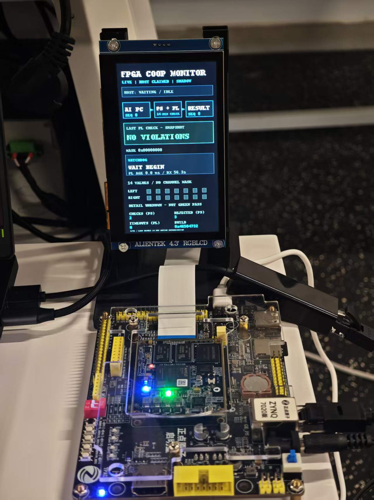

# 基于 Ryzen AI 与 Zynq 的双臂具身智能项目

中文 | [English](readme.md)

这是一个双臂叠毛巾研究原型：使用两只 AgileX Piper 机械臂、三路 RGB 相机、AMD Ryzen AI PC 和 Zynq-7020 FPGA。ACT 生成基础动作块，SmolVLA 通过异步 guided RTC 提供受约束的手臂修正；其视觉编码器运行于独立 NPU 工作进程，其余策略与控制走 ROCm/PyTorch 路径。

**当前状态：研究原型，尚非安全系统或已完成的比赛提交包。** FPGA 是异步诊断旁路，检查采样动作及反馈，将结果用于日志和显示；它不放行、阻断或停止机械臂。现有通信故障处理也不会自动停臂。完成 750 步不等于证明叠毛巾成功。

*LCD 实拍显示的是某一时刻的诊断状态，不能据此判断机械臂安全或任务成功。*

## 系统结构

三路相机和双臂反馈进入 AI PC；ACT 生成基础动作，SmolVLA 视觉子图由 NPU 执行并提供受限修正，主机融合并经 CAN 控制机械臂。同时，主机通过 UDP 异步发送采样到 Zynq：PS 处理协议和 AXI 访问，PL 固定点逻辑检查 14 维动作数据，结果返回主机并显示在板端屏幕。完整流程图见 [英文首页](readme.md#architecture)。

## 现有证据与缺口

- 一次现场记录完成 `execute=True` 的 750 个控制步，以动作预算结束；缺少可核验的独立折叠成功标注。
- 一次运行中 750 条 FPGA 任务样本均与整数软件参考一致，751 次请求（含一次探针）零超时；原始现场日志不随包公开。
- 750 条样本的 UDP 往返 P50/P95/P99/最大值为 4.644/5.313/7.175/25.537 ms，包含主机、网络、PS 和硬件处理，**不是**物理端到端时延。
- LCD + guard 构建报告记录 LUT 6,357、BRAM 96、WNS 4.616 ns；详细条件和证据见 [指标表](metrics/metrics.csv)。
- 任务成功率、传感器到执行器物理响应时延、AI 任务效果等仍待测；结果与原始证据、测量条件必须按赛题要求补齐。

## 目录

- `npu_deploy/`：AI PC 的 NPU 集成、设备检查、展示与运行脚本。
- `amd_hybrid_deploy_20261031/`：控制、部署、配置及保留许可信息的 LeRobot / ACT 参考代码。
- `fpga_integration/fpga_code/fpga_workspace/`：RTL、测试平台、Vivado 构建脚本、位流和实现报告。
- `fpga_integration/board_runtime/`：板端运行程序及已修正的会话逻辑。
- `docs/`：中英文技术说明、赛道要求及项目图像。
- `metrics/`、`tools/`：指标表及汇总脚本；不包含原始日志。
- `skill/`：可复用流程及当前验证边界。

目录是赛题推荐的 `host/`、`fpga/`、`metrics/`、`skill/` 结构的对应实现，详情见 [英文目录对照](readme.md#repository-guide)。

## 复现入口

1. 阅读 [中文技术报告](docs/technical_report_zh.md) 第 3、11 节及 [赛道要求](docs/track_requirements.md)。现场使用 Ubuntu、Python 3.12、ROCm 7.14.1 和 PYNQ Zynq-7020；实际环境需核对 [AMD 兼容性矩阵](https://rocm.docs.amd.com/projects/radeon-ryzen/en/latest/docs/compatibility/compatibility.html)。
2. 单独恢复项目自训练 ACT、SmolVLA 权重、处理器、驱动和模型资产；这些文件**不随包提供**，因此目前不能保证从全新仓库直接完整复现。源码中的旧路径和 IP 需要按实际硬件调整；`cobot_site.json` 中的设备序列号已替换为占位符，必须按实际设备重新填写。
3. 按 [展示指南](npu_deploy/showcase_guide_zh.md) 和 [FPGA 文档](fpga_integration/fpga_code/fpga_workspace/docs/)先进行只读设备检查和合成数据测试；个别历史文档保留其开发时状态，最终集成状态以技术报告为准。
4. 执行任何真实动作前，检查工作空间、设备绑定、限位、接线及独立急停。复位和策略脚本会驱动机械臂；Ctrl+C 和 FPGA 显示均不能代替急停。
5. 补齐独立定义的任务成功判据、物理端到端时延、任务效果、实测原始日志和其他赛题指标；公开原始数据前应单独检查可公开性。

更多信息：[中文技术报告](docs/technical_report_zh.md) · [英文技术说明](docs/technical_report_en.md) · [交付验证](docs/verification_zh.md) · [通信协议](fpga_integration/fpga_code/fpga_workspace/docs/protocol.md) · [可复用工作流](skill/readme.md)。引用项目与官方文档见 [英文首页](readme.md#references)。

## 许可

项目自有源码采用 Apache-2.0；第三方代码保留各自许可证和声明，模型权重及外部依赖遵循其各自条款。见 [第三方说明](amd_hybrid_deploy_20261031/third_party_notices.md)。
